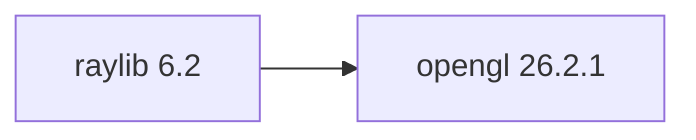

## Updated BuildEngine contract (10 November 2026)

**Declared configuration; no new test PASS.**

### Complete transitive dependencies

Direkt: `opengl@26.2.1`

### Current configuration

- `-DRAYLIB_SOURCE_DIR:PATH={Workspace}`
- `-DBCC64X_EXECUTABLE:FILEPATH={Tool:bcc64x}`
- `-DOPENGL_LIBRARY:FILEPATH={DependencyRoot:opengl}\lib\win64\{Configuration}\opengl32.lib`
- `-DCMAKE_INSTALL_PREFIX:PATH={BuildRoot}\stage\packages\{LibraryId}\{LibraryVersion}\{Configuration}`
- `-DCMAKE_INSTALL_LIBDIR:STRING=lib\win64\{Configuration}`
- `-DCMAKE_INSTALL_BINDIR:STRING=bin\win64\{Configuration}`
- `-DCMAKE_BUILD_TYPE:STRING=Release`
- `-DCMAKE_BUILD_TYPE:STRING=Debug`

---

## Historical integration notes

# raylib 6.2

[TOC|Content]

## Current BuildEngine contract (10 November 2026)

**Contract data, not verified build execution.** Earlier test results apply only to exact versions and builds; new runs remain **[not verified]**.

Simple cross-platform C library for graphics, audio, input, and game and application development.

**Coordinate:** `raylib@6.2` · **Category:** `graphics` · **License indicator:** `green`

### Declared dependencies (full transitive closure)

Edges come from exactly pinned XML dependencies. Dashed edges denote extensions, solid edges package dependencies. Bundled upstream components are not additional BuildEngine coordinates.

**Direct dependencies:** `opengl@26.2.1`

### Configuration and integration notes

**CMake arguments:**

- `-DRAYLIB_SOURCE_DIR:PATH={Workspace}`
- `-DBCC64X_EXECUTABLE:FILEPATH={Tool:bcc64x}`
- `-DOPENGL_LIBRARY:FILEPATH={DependencyRoot:opengl}\lib\win64\{Configuration}\opengl32.lib`
- `-DCMAKE_INSTALL_PREFIX:PATH={BuildRoot}\stage\packages\{LibraryId}\{LibraryVersion}\{Configuration}`
- `-DCMAKE_INSTALL_LIBDIR:STRING=lib\win64\{Configuration}`
- `-DCMAKE_INSTALL_BINDIR:STRING=bin\win64\{Configuration}`
- `-DCMAKE_BUILD_TYPE:STRING=Release`
- `-DCMAKE_BUILD_TYPE:STRING=Debug`

**Versionsgebundene Patches:**

- `{Workspace}\.buildengine\patches\{LibraryVersion}\bcc64x-c-bool.patch`
- `{BuildFileDir}\patches\raylib\6.2\bcc64x-c-bool.patch`

**Source-Downloads:**

- `https://github.com/raysan5/raylib/archive/02566453880e06bec97f5b8160fa6fe1e98397ca.zip`

**Deklarierte Smoke-Tests:**

- `consumer` / `Release` / `published` / `smokes\raylib\consumer`

**Explizit geforderte Installationsartefakte:**

- `{InstallRoot}\packages\{LibraryId}\{LibraryVersion}\bin\win64\{Configuration}\{BaseName}.dll`
- `{InstallRoot}\packages\{LibraryId}\{LibraryVersion}\lib\win64\{Configuration}\{BaseName}.lib`

**Verbindliche Sources:** `admin/build-libraries.xml` for configuration and pins; FSM/build logs for actual execution. [Library catalog](/manual/libraries.md).
