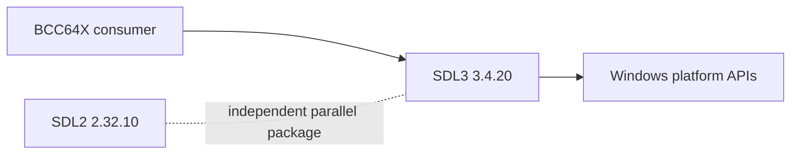

# SDL3 3.4.20: Native BCC64X integration

[TOC|Content]

## Purpose and architecture

SDL3 is an independent multimedia and game-development library. It coexists with SDL2 2.32.10 and does not replace or invalidate its existing BuildEngine package. The upstream C interface is retained without wrappers or fallback APIs.

**BuildEngine coordinate:** `sdl3@3.4.20`  
**Source:** `libsdl-org/SDL`, pinned release tag `release-3.4.20`  
**License:** zlib (upstream LICENSE.txt)  
**Toolchain:** Embarcadero C++Builder 13 / BCC64X, Win64x, dynamic runtime, Ninja/CMake.

## Build contract

The package uses a BuildEngine CMake adapter under `admin/cmake/adapters/sdl3` and upstream's own SDL3 targets. Shared build and installation remain enabled; static libraries, upstream samples and tests are not built. The adapter sets canonical `SDL3.dll` and `SDL3d.dll` with matching native import libraries and preserves SDL3's original APIs.

Both variant directories use `bin/win64/{Configuration}` and `lib/win64/{Configuration}`. A BuildEngine-specific `SDL3Config.cmake` exports the installed `SDL3::SDL3` target, with explicit Release and Debug DLL/import locations.

The consumer smoke initializes SDL without creating a display and verifies the major version. Installed DLL, import library, public header, license and CMake package are required by the package install gate.

## Dependency diagram

## Evidence

The pinned upstream release, CMake shared target, native headers and license were reviewed. **[not verified]** Native BCC64X Debug/Release builds, SDL3 DLL import naming, install checks and the executable smoke have not been executed in this repository review. No existing package was rebuilt or changed.
