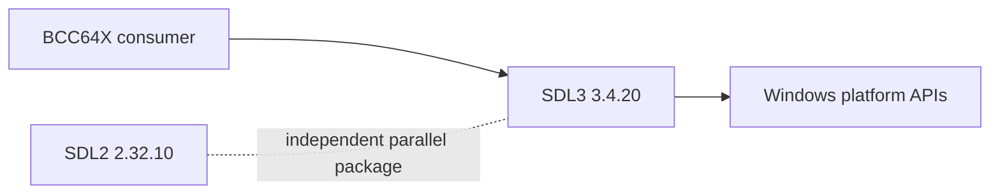

# SDL3 3.4.20: Native BCC64X integration

## SDL3 BCC64X C11 precompiled-header correction (17 November 2026)

- The SDL3 Release build reached Ninja after successful configuration but failed on many C translation units with BCC64X error E904: the generated PCH had C11 enabled while the consuming translation units did not. The root is SDL3's upstream `target_precompile_headers(SDL3-shared ...)` configuration, not DirectX and not separate source failures.
- The package adapter now sets `DISABLE_PRECOMPILE_HEADERS TRUE` **only for the `SDL3-shared` target** after loading the upstream subdirectory. Sources, dynamic runtime, DLL, and functional subsystem switches are unchanged; no modifications to other packages or global toolchain.
- **[not verified]** The subsequent native Debug/Release compilation, install artifact naming, and consumer smoke have not yet been observed.

## 17 November 2026: DirectX SDK detection under BCC64X

Both configurations failed during the upstream SDL3 CMake configure at `CMakeLists.txt:2216`. SDL3 assumed a legacy `DXSDK_DIR` installation when the compiler was neither MSVC nor MinGW. BuildEngine correctly uses BCC64X with the registered Windows SDK, without adopting either compiler identity. The SDL3-specific adapter now sets upstream's `USE_WINSDK_DIRECTX=TRUE` before loading the pinned source tree. It retains DirectX support and does not modify the global BCC64X toolchain. The adapter also makes the shared target's import prefix empty to match the package's `SDL3.lib` / `SDL3d.lib` import contract. **[not verified]** Subsequent CMake feature detection, compilation, installation and consumer smoke remain pending.

[TOC|Content]

## Purpose and architecture

SDL3 is an independent multimedia and game-development library. It coexists with SDL2 2.32.10 and does not replace or invalidate its existing BuildEngine package. The upstream C interface is retained without wrappers or fallback APIs.

**BuildEngine coordinate:** `sdl3@3.4.20`  
**Source:** `libsdl-org/SDL`, pinned release tag `release-3.4.20`  
**License:** zlib (upstream LICENSE.txt)  
**Toolchain:** Embarcadero C++Builder 13 / BCC64X, Win64x, dynamic runtime, Ninja/CMake.

## Build contract

The package uses a BuildEngine CMake adapter under `admin/cmake/adapters/sdl3` and upstream's own SDL3 targets. Shared build and installation remain enabled; static libraries, upstream samples and tests are not built. The adapter sets canonical `SDL3.dll` and `SDL3d.dll` with matching native import libraries and preserves SDL3's original APIs.

Both variant directories use `bin/win64/{Configuration}` and `lib/win64/{Configuration}`. A BuildEngine-specific `SDL3Config.cmake` exports the installed `SDL3::SDL3` target, with explicit Release and Debug DLL/import locations.

The consumer smoke initializes SDL without creating a display and verifies the major version. Installed DLL, import library, public header, license and CMake package are required by the package install gate.

## Dependency diagram

## Evidence

The pinned upstream release, CMake shared target, native headers and license were reviewed. **[not verified]** Native BCC64X Debug/Release builds, SDL3 DLL import naming, install checks and the executable smoke have not been executed in this repository review. No existing package was rebuilt or changed.
