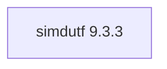

## Updated BuildEngine contract (10 November 2026)

**Declared configuration; no new test PASS.**

### Complete transitive dependencies

Direct: none

### Current configuration

- `-DCMAKE_TOOLCHAIN_FILE:FILEPATH={BuildFileDir}\cmake\toolchains\bcc64x-buildengine-cxx.cmake`
- `-DCMAKE_MAKE_PROGRAM:FILEPATH={Tool:ninja}`
- `-DCMAKE_INSTALL_PREFIX:PATH={InstallRoot}\packages\{LibraryId}\{LibraryVersion}`
- `-DCMAKE_INSTALL_INCLUDEDIR:STRING=include`
- `-DBUILD_SHARED_LIBS:BOOL=OFF`
- `-DSIMDUTF_TESTS:BOOL=OFF`
- `-DSIMDUTF_TOOLS:BOOL=OFF`
- `-DSIMDUTF_BENCHMARKS:BOOL=OFF`
- `-DSIMDUTF_ICONV:BOOL=OFF`
- `-DSIMDUTF_INSTALL_CMAKEDIR:STRING=lib/win64/{Configuration}/cmake/simdutf`
- `-DCMAKE_BUILD_TYPE:STRING=Release`
- `-DCMAKE_INSTALL_LIBDIR:STRING=lib/win64/Release`
- `-DCMAKE_INSTALL_BINDIR:STRING=bin/win64/Release`
- `-DCMAKE_BUILD_TYPE:STRING=Debug`
- `-DCMAKE_INSTALL_LIBDIR:STRING=lib/win64/Debug`
- `-DCMAKE_INSTALL_BINDIR:STRING=bin/win64/Debug`
- `-Dsimdutf_DIR:PATH={InstallRoot}\packages\{LibraryId}\{LibraryVersion}\lib\win64\Release\cmake\simdutf`

---

## Historical integration notes

# simdutf 9.3.3

[TOC|Content]

## Purpose and integration

SIMD accelerated Unicode and Base64 processing

**Status:** BuildEngine XML contract dated 10 November 2026; native builds and smoke results **[not verified]**.

## Dependencies including transitive levels

**Direct dependencies:** none

## Konfiguration

### CMake

- `-DCMAKE_TOOLCHAIN_FILE:FILEPATH={BuildFileDir}\cmake\toolchains\bcc64x-buildengine-cxx.cmake`
- `-DCMAKE_MAKE_PROGRAM:FILEPATH={Tool:ninja}`
- `-DCMAKE_INSTALL_PREFIX:PATH={InstallRoot}\packages\{LibraryId}\{LibraryVersion}`
- `-DCMAKE_INSTALL_INCLUDEDIR:STRING=include`
- `-DBUILD_SHARED_LIBS:BOOL=OFF`
- `-DSIMDUTF_TESTS:BOOL=OFF`
- `-DSIMDUTF_TOOLS:BOOL=OFF`
- `-DSIMDUTF_BENCHMARKS:BOOL=OFF`
- `-DSIMDUTF_ICONV:BOOL=OFF`
- `-DSIMDUTF_INSTALL_CMAKEDIR:STRING=lib/win64/{Configuration}/cmake/simdutf`
- `-DCMAKE_BUILD_TYPE:STRING=Release`
- `-DCMAKE_INSTALL_LIBDIR:STRING=lib/win64/Release`
- `-DCMAKE_INSTALL_BINDIR:STRING=bin/win64/Release`
- `-DCMAKE_BUILD_TYPE:STRING=Debug`
- `-DCMAKE_INSTALL_LIBDIR:STRING=lib/win64/Debug`
- `-DCMAKE_INSTALL_BINDIR:STRING=bin/win64/Debug`
- `-Dsimdutf_DIR:PATH={InstallRoot}\packages\{LibraryId}\{LibraryVersion}\lib\win64\Release\cmake\simdutf`

### Build environment

- `CB_BCC64X={Tool:bcc64x}`
- `CB_BDS={BDS}`
- `CB_LLVM_AR={Tool:llvm-ar}`
- `CB_BCC64X={Tool:bcc64x}`
- `CB_BDS={BDS}`

### Sources

- `https://github.com/simdutf/simdutf/archive/refs/tags/v9.3.3.tar.gz`

### Consumer-Smoke

- `consumer / Release / package`

## Special considerations

Versioned source/build actions and necessary BCC64X patches are defined in `admin/build-libraries.xml`. A recorded fix is not a test PASS without FSM evidence.

[Library overview](/manual/libraries.md)
