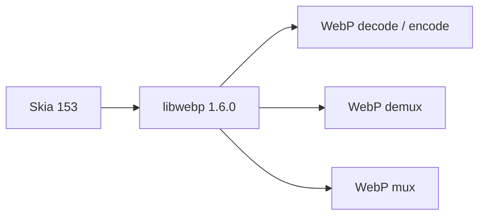
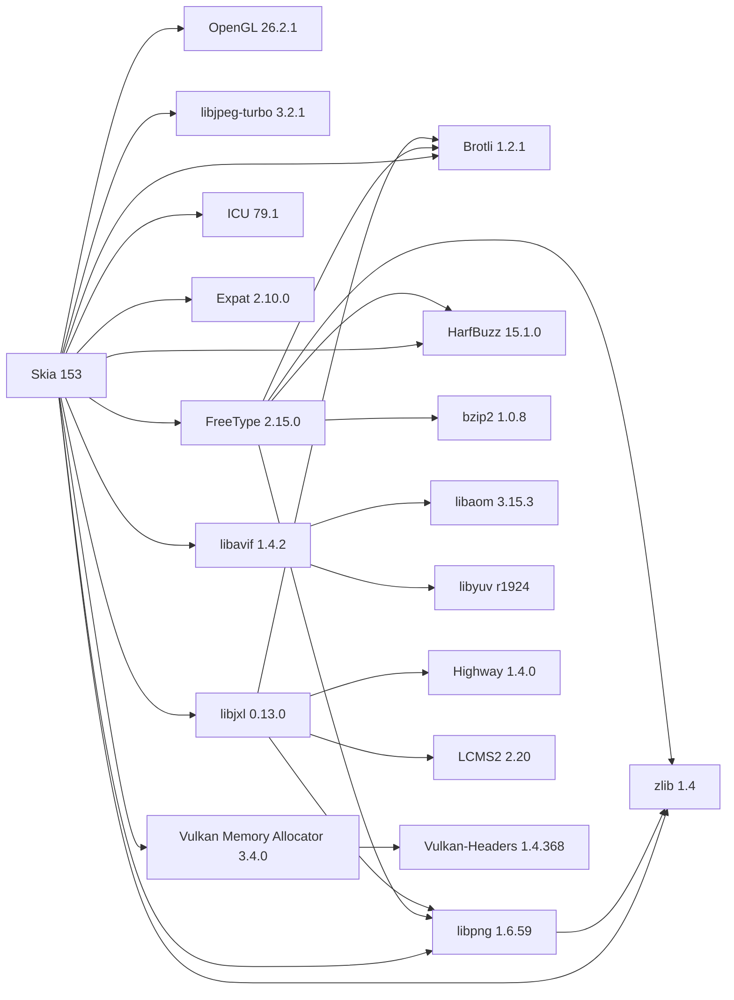
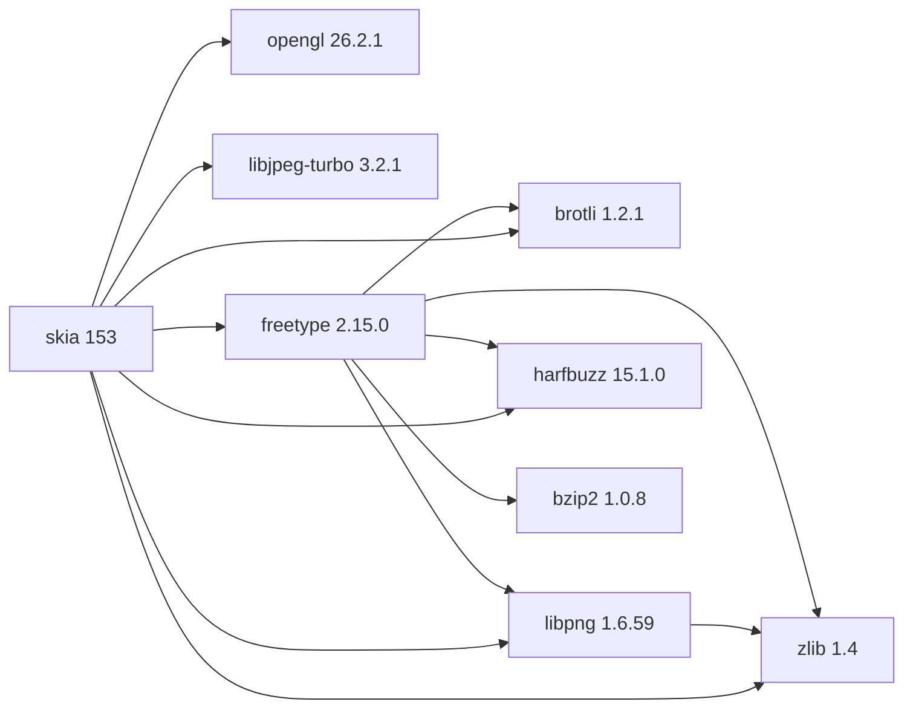

# Skia 153: BuildEngine integration and dependency provenance

## Current declarative integration (16 November 2026 audit)

The active schema-17 XML declares **17 direct Skia 153 dependencies**. Its version-pinned `bundled-components.json` lists the same **17 external BuildEngine coordinates**, without missing or extra entries. The manifest retains **five bundled components**: D3D12MemoryAllocator, dng_sdk, SPIRV-Headers, SPIRV-Tools, and glslang. These are declarations, not proof of native linkage or bundled-code elimination in the installed binaries.

The AV1 decode path is `Skia 153 -> libavif 1.4.2 -> libgav1 0.20.0`. libgav1 is also a direct Skia dependency for the FSM install gate and runtime search path. libavif selects `AVIF_CODEC_LIBGAV1=SYSTEM`, `AVIF_CODEC_AOM_DECODE=OFF`, `AVIF_CODEC_AOM_ENCODE=ON`, and `AVIF_LIBYUV=SYSTEM`. Its declared import library is `libgav1_shared.lib` from the matching BuildEngine variant. No Skia-local libgav1 download is declared.

**[not verified]** The revised libgav1, libavif, and Skia Debug/Release BCC64X builds, actual PE import closure, and AVIF decode smoke have no new matching execution evidence in this audit. The operator-confirmed 109/109 FSM completion was for an earlier contract. The dated integration notes below are retained as engineering history and must not override this section or the active XML.

## Correction: Python helper steps withdrawn (15 November 2026)

The previously added Python scripts `ensure_skia_webp_gn.py` and `verify_skia_webp_gn.py` and their Skia build invocations have been **removed**. The earlier entries below describing them as active are historical and superseded by this correction. External WebP integration must remain in the version-pinned GN patch and the existing BuildEngine XML source preparation actions; do not introduce auxiliary Python orchestration or silently edit staged source trees during the build phase. The unresolved WebP issue is not declared fixed, and no successful Skia build has been verified.


## Staged Skia source without the original external WebP patch (15 November 2026)

The subsequent Debug and Release runs failed immediately at `synchronize-managed-libwebp-gn` with `Staged third_party/libwebp/BUILD.gn lacks the external WebP GN patch`. This proves that the already-staged Skia source had not received the earlier source-phase externalization patch; the prior synchronization script only rejected this state.

The synchronization script now recognizes the **exact pinned upstream GN declaration and system import target**, and installs the already-declared external WebP arguments, managed import paths, and codec include configs directly in the staged source before `gn gen`. It is idempotent, refuses unknown or conflicting GN layouts, and uses a Windows source-tree lock so parallel Debug and Release jobs do not write the same GN files concurrently. The post-generation `gn desc` verifier remains the required gate before Ninja. Existing producer packages are untouched.

This is a source/build phase recovery, not evidence of a successful Skia Debug or Release build.


## Incremental WebP GN source synchronization (15 November 2026)

Skia's source phase may have completed before the last versioned `bcc64x-system-libwebp.patch` update, leaving both source `BUILD.gn` files and the generated Ninja graph stale. The BuildEngine XML now runs `admin/scripts/ensure_skia_webp_gn.py` **before GN generation**, which requires the prior external-libwebp patch to be present and idempotently adds the managed include config to both `webp_decode` and `webp_encode` when missing. It deliberately rejects unexpected upstream layouts or any attempt to switch a bundled WebP target without the required import wiring.

A separate `verify_skia_webp_gn.py` step executes **after GN generation and before Ninja**, checks the installed WebP headers and the GN-described include directories of both codec targets, and fails immediately with the actual GN directories if the expected managed path is absent. This combination handles cached/staged source trees without weakening the explicit versioned patch contract. **No new Debug/Release build result has been supplied yet.**


## Follow-up: repeated WebP header errors and staged source verification (15 November 2026)

Both Debug and Release still report `F1129` for `webp/encode.h` in `SkWebpEncoderImpl.cpp` (and the previous Release run also failed to locate `webp/decode.h` in `SkWebpCodec.cpp`). The library `libwebp@1.6.0` was already reported successfully built by the operator. The BuildEngine XML does set `skia_use_system_libwebp = true` and provide `CB_SKIA_LIBWEBP_INCLUDE`, and the versioned GN patch explicitly attaches `managed_webp_includes` to the two WebP targets. Repeating the same fatal error therefore requires inspecting the **effective staged Skia source and generated GN/Ninja output**, not another blind change to the producer.

The Skia build contract now executes `admin/scripts/verify_skia_webp_gn.py` after `gn gen` and before the expensive Ninja compilation. This verifies the installed `include/webp/encode.h` and `decode.h` exist and checks `gn desc` for the managed include root on both `//:webp_decode` and `//:webp_encode`. If a previously prepared source workspace bypassed the updated source patch phase, the check fails early and identifies the missing generated include instead of compiling 800 or more files. **This does not prove the patch has been re-applied to any particular running workspace.** A fresh source preparation plus GN generation is necessary to adopt a changed patch in an existing staged tree.

### Externalization status

- **libwebp 1.6.0:** independent managed DLL, reported PASS by the operator, configured as an external Skia dependency; the Skia compile/link is still failing.
- **Wuffs 0.3:** managed source-only BuildEngine package; Skia copies the installed Wuffs source and compiles it in its own target. It is externally *sourced*, not an independently linked DLL. The SBOM manifest now declares this managed source coordinate externally.
- **PIE-X 0.27:** registered as an independent package candidate, but `skia_use_piex = false`; no active Skia PIE-X build, import or replacement is claimed.
- **libgav1:** still a Skia-bundled, pinned source; no independent `libgav1` entry exists in the BuildEngine XML as of this revision. Its Windows-thread implementation remains in the Skia-specific patch. A separate BCC64X producer and GN consumer verification are required before removing that source.

The updated Skia SBOM manifest retains only genuinely bundled active components, and now names Wuffs together with the other BuildEngine-managed dependencies. Installing the new Skia package and generating the SBOM remain unverified.


## libwebp GN include propagation fix (15 November 2026)

The Release Skia rebuild stopped at Ninja step 843/1218 after two failed codec compilations: `src/encode/SkWebpEncoderImpl.cpp` could not find `webp/encode.h`, and `src/codec/SkWebpCodec.cpp` could not find `webp/decode.h`. The emitted compiler invocations lacked the managed `{DependencyRoot:libwebp}/include` directory. The original external `system("libwebp")` target attached `include_dirs` to a GN group configuration that does not propagate the includes to the separate `webp_decode` and `webp_encode` source sets.

The versioned `bcc64x-system-libwebp.patch` now adds `config("managed_webp_includes")` and attaches it explicitly to both codec source targets in Skia's root `BUILD.gn`. This keeps the include root driven by the existing `CB_SKIA_LIBWEBP_INCLUDE` GN argument, with no hardcoded absolute paths or changes to the successfully built libwebp producer. All four patch hunks were checked against the pinned Skia source; Debug/Release compilation and linking of the revised consumer are **not yet verified**.


## Managed libwebp externalization (15 November 2026)

Skia 153 now declares `libwebp@1.6.0` as a direct BuildEngine dependency, uses `skia_use_system_libwebp = true` with WebP decode/encode enabled, and receives per-configuration import library paths via `DependencyRoot:libwebp` and a version-pinned `bcc64x-system-libwebp.patch`. The previous Skia-bundled WebP archive and extract actions were removed. The SBOM manifest tracks libwebp as external, not bundled; inactive PIE-X is also absent from the bundled list.

**Validation pending:** The supplied libwebp Release log failed because upstream `WEBP_ENABLE_SIMD=OFF` introduced `-mno-sse2`, producing E714 floating-point ABI errors and compiler crashes. The producer was reconfigured with `WEBP_ENABLE_SIMD=ON`; no successful retest, DLL import-library-name verification, GN generation, Skia Debug/Release link or loader smoke is yet available. The historical 109/109 FSM result predates these changes.

### Updated direct dependency



The XML now declares 14 direct dependencies, including Wuffs (source-only) and libwebp (expected DLL imports). The complete external closure and SBOM count must be recalculated from the rebuilt installation, not copied from the historical 12-dependency snapshot below. Verify 16-bit RGB565/BGR565 pixel order specifically: Skia's earlier bundled WebP build used the non-standard `WEBP_SWAP_16BIT_CSP` compile definition, whereas a standalone upstream WebP codec does not necessarily preserve this behavior.

## PIE-X 0.27 independent producer (15 November 2026)

The PIE-X native package `piex@0.27` now has its own BuildEngine XML entry and CMake adapter. No BCC64X DLL build PASS, Skia ABI check, RAW preview smoke, or external GN link PASS has been confirmed. Therefore Skia remains configured with `skia_use_piex = false` and does not gain an unverified direct dependency. [PIE-X 0.27 integration](/package/piex/0.27/migration).

## PIE-X cleanup and libwebp producer (15 November 2026)

The source contract no longer downloads or extracts PIE-X because `skia_use_piex = false`. This is a configuration change and not a new build PASS. DNG SDK remains active.

`libwebp@1.6.0` is now registered as an independent BuildEngine producer, but it is not yet a validated DLL import for Skia. The GN externalization and removal of the bundled source are now declared, but they remain unverified by an actual Skia rebuild. The 109/109 PASS result predates the new registration. [libwebp integration guide](/package/libwebp/1.6.0/migration).

## Pending Skia source reduction (15 November 2026)

**Configuration changed; build validation pending.** The registered Skia 153 source contract now consumes the separately installed `wuffs@0.3` source through `{DependencyRoot:wuffs}`. Wuffs is a single-file C distribution and remains compiled by the Skia GN target with Skia's GIF module definitions; no independently linked Wuffs DLL is claimed.

Skia's redundant source downloads and extraction actions for **libyuv** and **Vulkan-Headers** were removed. libyuv remains an external transitive dependency through libavif 1.4.2. Vulkan-Headers remains a transitive dependency through Vulkan Memory Allocator 3.4.0, and the pre-existing BCC64X GN patch selects installed Vulkan headers. These changes require a new Skia source/configure/build/install and SBOM pass before they can be called verified.

**The separate libwebp externalization remains pending:** `libwebp@1.6.0` is now registered, but its producer DLL/import library and Skia consumer GN wiring are not verified. The XML now enables `skia_use_system_libwebp` with managed GN import paths; installed artifacts and actual linkage still require validation. The standalone SPIR-V packages likewise do not yet replace Skia's pinned internal SPIR-V GN closure; retain their downloads until the debug validator's generated targets and compatible binaries are wired to managed packages.

After a successful rebuild, the *expected* installed package breakdown is **29 components = 1 root + 19 external dependencies + 9 bundled components**, with 13 direct and 6 transitive external coordinates. These are predicted from the updated contract, not a reported test result.

## Current BuildEngine status (15 November 2026)

**Build result: PASS.** The operator confirmed successful completion of all **109 of 109 versioned library integrations**. This is the observed final FSM outcome, not merely a registered source contract. Individual downstream application tests and a separate proof of binary externalization are not implied by that result.

The Skia M153 source is pinned to revision `2eed75b956045eb8603d3690a1e84bc582a2135d`. The XML contract declares **12 direct dependencies**, six additional distinct transitive external coordinates, and a separately tracked bundled component inventory. The installed package report last showed **29 total components = 1 Skia root + 18 external + 10 bundled**.

### Complete external BuildEngine dependency graph



**Counters:** Total Components = 29; Direct Dependencies = 12; Transitive Dependencies = 6; Bundled Components = 10; Total External Dependencies = 18. These figures reflect the last reported installed SBOM. The server calculates the live values from its installed package graph rather than persisting these example counts.

### Active GN and integration characteristics

- BCC64X x64 target, Ninja/GN generation, component build; Ganesh and Graphite enabled with OpenGL, Direct3D and Vulkan backends
- Externally configured: zlib, Brotli, libjpeg-turbo, libpng, FreeType, HarfBuzz, ICU, Expat, libavif and libjxl; Vulkan Memory Allocator and OpenGL are separately managed BuildEngine dependencies
- The currently accepted Expat import naming convention is `liblibexpat.lib` (Release) and `liblibexpatd.lib` (Debug). The BuildEngine XML resolves their package roots and configurations; no absolute path is declared
- Highway is external through libjxl, libyuv through libavif, and Vulkan-Headers through the Vulkan Memory Allocator; these are not direct Skia XML dependencies
- The bundled-component SBOM manifest excludes Highway, libyuv and Vulkan-Headers from its external-coordinate duplicates. **This SBOM correction alone does not prove that all upstream copies have been removed from Skia's source or link graph**
- SPIRV-Cross, SPIRV-Headers, SPIRV-Tools, and glslang remain pinned inside the Skia source workflow. The standalone BuildEngine packages exist, but GN externalization is still a separate engineering change. Debug SPIR-V validation remains enabled by the versioned patch

### New version-specific integration guides

[libavif 1.4.2](/package/libavif/1.4.2/migration) · [libjxl 0.13.0](/package/libjxl/0.13.0/migration) · [libaom 3.15.3](/package/libaom/3.15.3/migration) · [libyuv r1924](/package/libyuv/r1924/migration) · [Highway 1.4.0](/package/highway/1.4.0/migration) · [SPIRV-Tools 2026.4](/package/spirv-tools/2026.4/migration) · [glslang 16.6.0](/package/glslang/16.6.0/migration)

The following historical section records earlier configuration iterations. It is retained for change history; use this section and the current XML contract for the active state.

---

## Updated BuildEngine contract (10 November 2026)

**Declared configuration; no new test PASS.**

### Complete transitive dependencies



Direct dependencies in the earlier configuration: `opengl@26.2.1`, `zlib@1.4`, `brotli@1.2.1`, `libjpeg-turbo@3.2.1`, `libpng@1.6.59`, `harfbuzz@15.1.0`, `freetype@2.15.0`.

### Current configuration


```gn
skia_use_bcc64x = true
target_cpu = "x64"
target_cc = "bcc64x"
target_cxx = "bcc64x"
target_link = "bcc64x"
target_ar = "llvm-ar"
python_executable = getenv("CB_PYTHON")
bcc64x_rad_lib_dir = getenv("CB_BDS") + "/lib/win64x/release"
bcc64x_rad_psdk_lib_dir = getenv("CB_BDS") + "/lib/win64x/release/psdk"
extra_ldflags = [getenv("CB_BCC64X_UCRT_COMPAT")]
bcc64x_opengl_lib = getenv("CB_SKIA_OPENGL_LIB")
bcc64x_zlib_include = getenv("CB_SKIA_ZLIB_INCLUDE")
bcc64x_zlib_lib = getenv("CB_SKIA_ZLIB_LIB")
bcc64x_brotli_include = getenv("CB_SKIA_BROTLI_INCLUDE")
bcc64x_brotli_common_lib = getenv("CB_SKIA_BROTLI_COMMON_LIB")
bcc64x_brotli_decode_lib = getenv("CB_SKIA_BROTLI_DECODE_LIB")
bcc64x_libpng_include = getenv("CB_SKIA_LIBPNG_INCLUDE")
bcc64x_libpng_lib = getenv("CB_SKIA_LIBPNG_LIB")
bcc64x_libjpeg_include = getenv("CB_SKIA_LIBJPEG_INCLUDE")
bcc64x_libjpeg_lib = getenv("CB_SKIA_LIBJPEG_LIB")
bcc64x_harfbuzz_include = getenv("CB_SKIA_HARFBUZZ_INCLUDE")
bcc64x_harfbuzz_lib = getenv("CB_SKIA_HARFBUZZ_LIB")
bcc64x_harfbuzz_subset_lib = getenv("CB_SKIA_HARFBUZZ_SUBSET_LIB")
skia_system_freetype2_include_path = getenv("CB_SKIA_FREETYPE_INCLUDE")
skia_system_freetype2_lib = getenv("CB_SKIA_FREETYPE_LIB")
is_official_build = {SkiaOfficialBuild}
is_debug = {SkiaDebug}
is_component_build = true
is_trivial_abi = false
skia_enable_tools = false
skia_build_fuzzers = false
skia_build_rust_targets = false
skia_use_partition_alloc = false
skia_enable_precompile = true
skia_enable_discrete_gpu = true
skia_enable_gpu_debug_layers = false
skia_generate_workarounds = false
skia_enable_ganesh = true
skia_enable_graphite = true
skia_use_gl = true
skia_use_direct3d = true
skia_use_vulkan = true
skia_use_vma = true
skia_enable_spirv_validation = false
skia_use_dawn = false
skia_use_angle = false
skia_use_egl = false
skia_use_epoxy_egl = false
skia_use_webgl = false
skia_use_webgpu = false
skia_enable_fontmgr_win = true
skia_enable_fontmgr_win_gdi = true
skia_use_freetype = true
skia_use_system_freetype2 = true
skia_use_freetype_woff2 = true
skia_use_freetype_svg = true
skia_use_freetype_zlib = true
skia_use_freetype_zlib_bundled = false
skia_enable_fontmgr_custom_directory = true
skia_enable_fontmgr_custom_embedded = true
skia_enable_fontmgr_custom_empty = true
skia_use_fontconfig = false
skia_use_fontations = false
skia_use_icu = true
skia_use_system_icu = false
skia_enable_skunicode = true
skia_use_harfbuzz = true
skia_use_system_harfbuzz = true
skia_pdf_subset_harfbuzz = true
skia_use_client_icu = false
skia_use_bidi = false
skia_use_icu4x = false
skia_use_libgrapheme = false
skia_use_expat = true
skia_use_system_expat = false
skia_enable_pdf = true
skia_use_xps = true
skia_enable_svg = true
skia_enable_skottie = true
skia_use_libpng_decode = true
skia_use_libpng_encode = true
skia_use_no_png_encode = false
skia_use_system_libpng = true
skia_use_libjpeg_turbo_decode = true
skia_use_libjpeg_turbo_encode = true
skia_use_no_jpeg_encode = false
skia_use_system_libjpeg_turbo = true
skia_use_jpeg_gainmaps = true
skia_use_libwebp_decode = true
skia_use_libwebp_encode = true
skia_use_no_webp_encode = false
skia_use_system_libwebp = false
skia_use_wuffs = true
skia_include_multiframe_procs = true
skia_use_libavif = true
skia_use_crabbyavif = false
skia_use_libjxl_decode = true
skia_use_dng_sdk = true
skia_use_piex = false
skia_use_system_brotli = true
skia_use_zlib = true
skia_use_system_zlib = true
skia_use_rust_png_decode = false
skia_use_rust_png_encode = false
skia_use_rust_jpeg_decode = false
skia_use_rust_jpeg_encode = false
skia_use_rust_bmp_decode = false
skia_use_rust_ico_decode = false
skia_use_rust_exif = false
skia_use_rust_icc = false
skia_use_ffmpeg = false
skia_use_lua = false
skia_use_perfetto = false
skia_use_pprof = false
skia_use_sfml = false
skia_enable_vello_shaders = false
extra_cflags = ["-DWIN32_LEAN_AND_MEAN","-DNOMINMAX"]
```

---

## Historical integration notes

# skia 153: BCC64X migration and integration record

[TOC|Content]

**Contract identity:** `skia@153` · **Category:** graphics · **Target:** RAD Studio 13 / native BCC64X / Windows x64.

**Evidence policy:** This document describes the version-specific, declared integration and the documented engineering decisions. A switch being present does not prove the corresponding upstream tests passed. Any result that is not backed by the FSM evidence or a maintained integration report is marked **[not verified]**.

## Purpose and integration strategy

Pin Skia to an exact upstream commit and build a broad Windows desktop rendering stack via GN/Ninja/BCC64X. The managed OpenGL, zlib, Brotli, JPEG, PNG, HarfBuzz and FreeType packages replace duplicated Skia producers; other upstream-pinned components remain bundled and are recorded in SBOM. Enable carefully selected CPU, GPU, SVG, PDF, XPS, image and animation paths but exclude unrelated web/mobile integrations.

**Why this boundary matters:** Each producer is controlled by the Admin XML and consumed via installed or published artifacts. Build variants and dependencies are explicit rather than discovered opportunistically from the developer workstation. Library product form (shared/static/header-only) is separate from the mandatory dynamic BCC64X Windows runtime for executable and DLL consumers (`-tR`).

## Dependency decisions

- `opengl@26.2.1`
- `zlib@1.3.2`
- `brotli@1.2.0`
- `libjpeg-turbo@3.2.0`
- `libpng@1.6.59`
- `harfbuzz@14.4.0`
- `freetype@2.14.3`

These are declared direct dependencies. Transitive runtime DLLs and package CMake imports must be resolved through the BuildEngine dependency graph; they are not evidence for linking arbitrary host copies.

## Product profile: what is enabled and what is not

The entries below are actual flags in `build-libraries.xml`, not a generic upstream capability list. **Enabled** means the declared setting requests the feature; **disabled** means this integration profile explicitly excludes it. BuildEngine variables such as `{TestsEnabled}` are runtime-resolved and must not be interpreted as unconditional ON/OFF.

### Enabled switches

No switches of this category are explicitly selected in the parsed build arguments.

### Deliberately disabled switches

No switches of this category are explicitly selected in the parsed build arguments.

### Other selected build features and external settings

No switches of this category are explicitly selected in the parsed build arguments.

### GN arguments for the pinned target graph

```gn
skia_use_bcc64x = true
target_cpu = "x64"
target_cc = "bcc64x"
target_cxx = "bcc64x"
target_link = "bcc64x"
target_ar = "llvm-ar"
python_executable = getenv("CB_PYTHON")
bcc64x_rad_lib_dir = getenv("CB_BDS") + "/lib/win64x/release"
bcc64x_rad_psdk_lib_dir = getenv("CB_BDS") + "/lib/win64x/release/psdk"
extra_ldflags = [getenv("CB_BCC64X_UCRT_COMPAT")]
bcc64x_opengl_lib = getenv("CB_SKIA_OPENGL_LIB")
bcc64x_zlib_include = getenv("CB_SKIA_ZLIB_INCLUDE")
bcc64x_zlib_lib = getenv("CB_SKIA_ZLIB_LIB")
bcc64x_brotli_include = getenv("CB_SKIA_BROTLI_INCLUDE")
bcc64x_brotli_common_lib = getenv("CB_SKIA_BROTLI_COMMON_LIB")
bcc64x_brotli_decode_lib = getenv("CB_SKIA_BROTLI_DECODE_LIB")
bcc64x_libpng_include = getenv("CB_SKIA_LIBPNG_INCLUDE")
bcc64x_libpng_lib = getenv("CB_SKIA_LIBPNG_LIB")
bcc64x_libjpeg_include = getenv("CB_SKIA_LIBJPEG_INCLUDE")
bcc64x_libjpeg_lib = getenv("CB_SKIA_LIBJPEG_LIB")
bcc64x_harfbuzz_include = getenv("CB_SKIA_HARFBUZZ_INCLUDE")
bcc64x_harfbuzz_lib = getenv("CB_SKIA_HARFBUZZ_LIB")
bcc64x_harfbuzz_subset_lib = getenv("CB_SKIA_HARFBUZZ_SUBSET_LIB")
skia_system_freetype2_include_path = getenv("CB_SKIA_FREETYPE_INCLUDE")
skia_system_freetype2_lib = getenv("CB_SKIA_FREETYPE_LIB")
is_official_build = {SkiaOfficialBuild}
is_debug = {SkiaDebug}
is_component_build = true
is_trivial_abi = false
skia_enable_tools = false
skia_build_fuzzers = false
skia_build_rust_targets = false
skia_use_partition_alloc = false
skia_enable_precompile = true
skia_enable_discrete_gpu = true
skia_enable_gpu_debug_layers = false
skia_generate_workarounds = false
skia_enable_ganesh = true
skia_enable_graphite = true
skia_use_gl = true
skia_use_direct3d = true
skia_use_vulkan = true
skia_use_vma = true
skia_enable_spirv_validation = false
skia_use_dawn = false
skia_use_angle = false
skia_use_egl = false
skia_use_epoxy_egl = false
skia_use_webgl = false
skia_use_webgpu = false
skia_enable_fontmgr_win = true
skia_enable_fontmgr_win_gdi = true
skia_use_freetype = true
skia_use_system_freetype2 = true
skia_use_freetype_woff2 = true
skia_use_freetype_svg = true
skia_use_freetype_zlib = true
skia_use_freetype_zlib_bundled = false
skia_enable_fontmgr_custom_directory = true
skia_enable_fontmgr_custom_embedded = true
skia_enable_fontmgr_custom_empty = true
skia_use_fontconfig = false
skia_use_fontations = false
skia_use_icu = true
skia_use_system_icu = false
skia_enable_skunicode = true
skia_use_harfbuzz = true
skia_use_system_harfbuzz = true
skia_pdf_subset_harfbuzz = true
skia_use_client_icu = false
skia_use_bidi = false
skia_use_icu4x = false
skia_use_libgrapheme = false
skia_use_expat = true
skia_use_system_expat = false
```

**GN false switches:** `is_trivial_abi = false`, `skia_enable_tools = false`, `skia_build_fuzzers = false`, `skia_build_rust_targets = false`, `skia_use_partition_alloc = false`, `skia_enable_gpu_debug_layers = false`, `skia_generate_workarounds = false`, `skia_enable_spirv_validation = false`, `skia_use_dawn = false`, `skia_use_angle = false`, `skia_use_egl = false`, `skia_use_epoxy_egl = false`, `skia_use_webgl = false`, `skia_use_webgpu = false`, `skia_use_freetype_zlib_bundled = false`, `skia_use_fontconfig = false`, `skia_use_fontations = false`, `skia_use_system_icu = false`, `skia_use_client_icu = false`, `skia_use_bidi = false`, `skia_use_icu4x = false`, `skia_use_libgrapheme = false`, `skia_use_system_expat = false`. These are build-profile exclusions, not a claim about unsupported upstream capabilities.


## Build architecture, variants and paths

**Selected build flow:** GN/Ninja and explicit native toolchain targets. **Declared variants:** Release, Debug. **State boundary:** Source acquisition and version-bound patches precede the build; install and publication consume completed variant artifacts.

**Representative compiler, installation and workflow arguments:**

- None declared for this category.

**Versioned source locations:**

- `https://github.com/GPUOpen-LibrariesAndSDKs/D3D12MemoryAllocator/archive/169895d529dfce00390a20e69c2f516066fe7a3b.tar.gz`
- `https://android.googlesource.com/platform/external/dng_sdk.git/+archive/dbe0a676450d9b8c71bf00688bb306409b779e90.tar.gz`
- `https://chromium.googlesource.com/external/github.com/libexpat/libexpat.git/+archive/6154446fccefbf3ca644894f598969113b0c7bcd.tar.gz`
- `https://chromium.googlesource.com/external/github.com/google/highway.git/+archive/457c891775a7397bdb0376bb1031e6e027af1c48.tar.gz`
- `https://chromium.googlesource.com/chromium/deps/icu.git/+archive/d578f2e8b7bd5938e21cfb6bf15c079e0aa5b738.tar.gz`
- `https://github.com/AOMediaCodec/libavif/archive/55aab4ac0607ab651055d354d64c4615cf3d8000.tar.gz`
- `https://chromium.googlesource.com/codecs/libgav1.git/+archive/5cf722e659014ebaf2f573a6dd935116d36eadf1.tar.gz`
- `https://chromium.googlesource.com/external/gitlab.com/wg1/jpeg-xl.git/+archive/332feb17d17311c748445f7ee75c4fb55cc38530.tar.gz`
- `https://chromium.googlesource.com/webm/libwebp.git/+archive/845d5476a866141ba35ac133f856fa62f0b7445f.tar.gz`
- `https://chromium.googlesource.com/libyuv/libyuv.git/+archive/d248929c059ff7629a85333699717d7a677d8d96.tar.gz`
- `https://android.googlesource.com/platform/external/piex.git/+archive/bb217acdca1cc0c16b704669dd6f91a1b509c406.tar.gz`
- `https://github.com/google/wuffs-mirror-release-c/archive/e3f919ccfe3ef542cfc983a82146070258fb57f8.tar.gz`

**Declared extraction profiles:**

- `zip / skia-2eed75b956045eb8603d3690a1e84bc582a2135d`

**Package-path convention:** `{InstallRoot}/packages/skia/153/`; variant-specific binaries/import libraries generally use `lib/win64/{Configuration}` and `bin/win64/{Configuration}`, unless the actual per-library install contract specifies another layout. The XML is authoritative for each copied file; do not assume every package has all these directories.

## Difficulties, workarounds and unavoidable patches

Skia component exporting and the absolute import-library flag propagation must remain targeted; indiscriminate `--export-all-symbols` is explicitly rejected by the existing integration report. The generic BCC64X UCRT fix is a generated toolchain archive, not a source patch in Skia.

| Version-bound patch | Problem and justification |
| --- | --- |
| `admin/patches/skia/2eed75b956045eb8603d3690a1e84bc582a2135d/bcc64x-d3d-getdesc.patch` | Repair Windows Direct3D descriptor/API signature compatibility under BCC64X. |
| `admin/patches/skia/2eed75b956045eb8603d3690a1e84bc582a2135d/bcc64x-debug-spirv-validator.patch` | Correct the conditional wiring of the Debug SPIR-V validation target. |
| `admin/patches/skia/2eed75b956045eb8603d3690a1e84bc582a2135d/bcc64x-desktop.patch` | Adapt the Windows desktop code paths for modern BCC64X compiler and SDK semantics. |
| `admin/patches/skia/2eed75b956045eb8603d3690a1e84bc582a2135d/bcc64x-gn.patch` | Provide the GN BCC64X compiler/linker/toolchain contract absent upstream. |
| `admin/patches/skia/2eed75b956045eb8603d3690a1e84bc582a2135d/bcc64x-harfbuzz-system.patch` | Route shaping to the exact managed HarfBuzz package. |
| `admin/patches/skia/2eed75b956045eb8603d3690a1e84bc582a2135d/bcc64x-libgav1-winthreads.patch` | Adapt bundled libgav1 Windows threading compatibility. |
| `admin/patches/skia/2eed75b956045eb8603d3690a1e84bc582a2135d/bcc64x-skarenaalloc-export.patch` | Export SkArenaAlloc across the applicable Skia component boundary. |
| `admin/patches/skia/2eed75b956045eb8603d3690a1e84bc582a2135d/bcc64x-system-brotli.patch` | Replace Skia's internal Brotli link with the managed producer. |
| `admin/patches/skia/2eed75b956045eb8603d3690a1e84bc582a2135d/bcc64x-system-freetype.patch` | Consume the managed FreeType headers and import library. |
| `admin/patches/skia/2eed75b956045eb8603d3690a1e84bc582a2135d/bcc64x-system-libjpeg-turbo.patch` | Consume managed libjpeg-turbo without a duplicated bundled producer. |
| `admin/patches/skia/2eed75b956045eb8603d3690a1e84bc582a2135d/bcc64x-system-libpng.patch` | Consume managed libpng without a duplicated bundled producer. |
| `admin/patches/skia/2eed75b956045eb8603d3690a1e84bc582a2135d/bcc64x-system-link-propagation.patch` | Propagate raw absolute Windows/BCC64X linker flags through GN target chains; GN -l rewriting is unsuitable. |
| `admin/patches/skia/2eed75b956045eb8603d3690a1e84bc582a2135d/bcc64x-zlib-link.patch` | Link the managed zlib variant correctly from the GN graph. |

### Declarative repairs and preparation actions

- `patch-check`
- `patch-apply`
- `system-link-propagation-patch-check`
- `system-link-propagation-patch-apply`
- `desktop-patch-check`
- `desktop-patch-apply`
- `debug-spirv-validator-patch-check`
- `debug-spirv-validator-patch-apply`
- `skarenaalloc-export-patch-check`
- `skarenaalloc-export-patch-apply`
- `zlib-link-patch-check`
- `zlib-link-patch-apply`
- `system-brotli-patch-check`
- `system-brotli-patch-apply`
- `system-libjpeg-turbo-patch-check`
- `system-libjpeg-turbo-patch-apply`
- `system-libpng-patch-check`
- `system-libpng-patch-apply`
- `system-freetype-patch-check`
- `system-freetype-patch-apply`
- `harfbuzz-system-patch-check`
- `harfbuzz-system-patch-apply`
- `libgav1-winthreads-patch-check`
- `libgav1-winthreads-patch-apply`
- `d3d-getdesc-patch-check`

These steps are owned by the XML-driven FSM, not by a separately invoked ad hoc build script. The presence of an action is not a license to run it concurrently from Debug and Release if it changes shared source.
### Engineering constraints recorded in the executable contract

- Broad Windows desktop profile. BuildEngine-provided external dependencies: OpenGL 26.2.1 zlib 1.3.2 Brotli 1.2.0 libjpeg-turbo 3.2.0 libpng 1.6.59 HarfBuzz 14.4.0 FreeType 2.14.3 These components are NOT downloaded or rebuilt inside Skia. Their exact package versions are represented by BuildEngine dependencies above. Bundled Skia dependencies remain pinned to the commits selected by this Skia revi
- ========================================================
- Bundled compression / text / image dependencies.
- Generic BuildEngine action. Inspect every pinned sibling download before any expensive source extraction or build starts.
- Populate bundled third_party\externals only.
- BuildEngine package dependencies are deliberately
- GitHub's pinned tarball contains a single D3D12MemoryAllocator-SHA directory, unlike the rootless Gitiles +archive tarball.
- GitHub pinned revision, root folder libavif-55aab4ac0607ab651055d354d64c4615cf3d8000. Verify pinned source before copying and remove the staging root.
- GitHub pinned revision, root folder wuffs-mirror-release-c-e3f919ccfe3ef542cfc983a82146070258fb57f8. Verify pinned source before copying and remove the staging root.
- GitHub pinned revision, root folder SPIRV-Headers-942fe4b988359a0750b79f0ae7ed735994d3147d. Verify pinned source before copying and remove the staging root.
- GitHub pinned revision, root folder SPIRV-Tools-388f5af1a6d4a4df4ab9bf69a1817255952e6ef1. Verify pinned source before copying and remove the staging root.
- BCC64X compatibility / system integration patches.
- Propagate raw BCC64X linker flags from Skia system dependency targets through source_set/group dependency chains to the final shared-library link.
- Restore the pinned Skia Vulkan debug validator source/dependency condition. bcc64x-desktop.patch had incorrectly tied this block to skia_enable_spirv_validation.
- Export SkArenaAlloc across Skia component DLL boundaries. modules/jsonreader is built as its own component DLL and depends on SkArenaAlloc implementation provided by skia.dll.
- Route Brotli, libjpeg-turbo and libpng through the already built and tested BuildEngine packages. Keep each integration in an independent patch so every patch can be checked against exactly one pinned upstream GN file.
- FreeType BuildEngine package integration.
- HarfBuzz BuildEngine package integration.

**Patch criterion:** A source or build-system patch is justified only when the selected upstream revision cannot satisfy this BCC64X contract by configuration or packaging alone. Version-bound patches must be checked against the exact source state and applied in their declared order. Packaging omissions and generic toolchain defects belong to their respective layers instead.

## Installation, publication and consumer responsibilities

**Explicit copy/repair destinations from the contract:**

- `{BuildRoot}\packages\{LibraryId}\{LibraryVersion}\{Configuration}\skia.dll -> {InstallRoot}\packages\{LibraryId}\{LibraryVersion}\bin\win64\{Configuration}\skia.dll`
- `{BuildRoot}\packages\{LibraryId}\{LibraryVersion}\{Configuration}\skia.lib -> {InstallRoot}\packages\{LibraryId}\{LibraryVersion}\lib\win64\{Configuration}\skia.lib`
- `{BuildRoot}\packages\{LibraryId}\{LibraryVersion}\{Configuration}\skunicode_core.dll -> {InstallRoot}\packages\{LibraryId}\{LibraryVersion}\bin\win64\{Configuration}\skunicode_core.dll`
- `{BuildRoot}\packages\{LibraryId}\{LibraryVersion}\{Configuration}\skunicode_core.lib -> {InstallRoot}\packages\{LibraryId}\{LibraryVersion}\lib\win64\{Configuration}\skunicode_core.lib`
- `{BuildRoot}\packages\{LibraryId}\{LibraryVersion}\{Configuration}\skunicode_icu.dll -> {InstallRoot}\packages\{LibraryId}\{LibraryVersion}\bin\win64\{Configuration}\skunicode_icu.dll`
- `{BuildRoot}\packages\{LibraryId}\{LibraryVersion}\{Configuration}\skunicode_icu.lib -> {InstallRoot}\packages\{LibraryId}\{LibraryVersion}\lib\win64\{Configuration}\skunicode_icu.lib`
- `{BuildRoot}\packages\{LibraryId}\{LibraryVersion}\{Configuration}\skshaper.dll -> {InstallRoot}\packages\{LibraryId}\{LibraryVersion}\bin\win64\{Configuration}\skshaper.dll`
- `{BuildRoot}\packages\{LibraryId}\{LibraryVersion}\{Configuration}\skshaper.lib -> {InstallRoot}\packages\{LibraryId}\{LibraryVersion}\lib\win64\{Configuration}\skshaper.lib`
- `{BuildRoot}\packages\{LibraryId}\{LibraryVersion}\{Configuration}\svg.dll -> {InstallRoot}\packages\{LibraryId}\{LibraryVersion}\bin\win64\{Configuration}\svg.dll`

**Declared smoke tests:**

- `consumer (Release, scope package; source smokes\skia\consumer)`
- `consumer (Debug, scope package; source smokes\skia\consumer)`

**Selected environment inputs:**

- `CB_BCC64X={Tool:bcc64x}`
- `CB_BDS={BDS}`
- `CB_LLVM_AR={Tool:llvm-ar}`
- `CB_PYTHON={Tool:python}`
- `CB_BCC64X_UCRT_COMPAT={Tool:bcc64x-ucrt-compat}`
- `CB_SKIA_OPENGL_LIB={InstallRoot}\packages\opengl\26.2.1\lib\win64\{Configuration}\opengl32.lib`
- `CB_SKIA_ZLIB_INCLUDE={InstallRoot}\packages\zlib\1.3.2\include`
- `CB_SKIA_ZLIB_LIB={InstallRoot}\packages\zlib\1.3.2\lib\win64\{Configuration}\{ZlibLibraryName}.lib`
- `CB_SKIA_BROTLI_INCLUDE={InstallRoot}\packages\brotli\1.2.0\include`
- `CB_SKIA_BROTLI_COMMON_LIB={InstallRoot}\packages\brotli\1.2.0\lib\win64\{Configuration}\libbrotlicommon.lib`
- `CB_SKIA_BROTLI_DECODE_LIB={InstallRoot}\packages\brotli\1.2.0\lib\win64\{Configuration}\libbrotlidec.lib`
- `CB_SKIA_LIBPNG_INCLUDE={InstallRoot}\packages\libpng\1.6.58\include`
- `CB_SKIA_LIBPNG_LIB={InstallRoot}\packages\libpng\1.6.58\lib\win64\{Configuration}\{LibPngLibraryName}.lib`
- `CB_SKIA_LIBJPEG_INCLUDE={InstallRoot}\packages\libjpeg-turbo\3.2.0\include`
- `CB_SKIA_LIBJPEG_LIB={InstallRoot}\packages\libjpeg-turbo\3.2.0\lib\win64\{Configuration}\{LibJpegLibraryName}.lib`
- `CB_SKIA_HARFBUZZ_INCLUDE={InstallRoot}\packages\harfbuzz\14.4.0\include\harfbuzz`
- `CB_SKIA_HARFBUZZ_LIB={InstallRoot}\packages\harfbuzz\14.4.0\lib\win64\{Configuration}\{HarfBuzzLibraryName}.lib`
- `CB_SKIA_HARFBUZZ_SUBSET_LIB={InstallRoot}\packages\harfbuzz\14.4.0\lib\win64\{Configuration}\{HarfBuzzSubsetLibraryName}.lib`
- `CB_SKIA_FREETYPE_INCLUDE={InstallRoot}\packages\freetype\2.14.3\include\freetype2`
- `CB_SKIA_FREETYPE_LIB={InstallRoot}\packages\freetype\2.14.3\lib\win64\{Configuration}\{FreeTypeLibraryName}.lib`

**Consumer rule:** Use the actual package export/target when present and the matching Debug/Release artifact and transitive dependency closure. An installed archive or DLL alone does not prove the installed application links, loads and releases resources correctly.

## Verification and evidence boundaries

The contract includes one or more upstream tests, validation actions or consumer smokes. Their mere declaration does not establish a successful execution; use the FSM state evidence and process logs for the specific version and configuration.

**Gate checklist:** source pin/extract → ordered checked patches → BCC64X compile/link → installed headers and exact artifacts → configured test suite → external installed-package consumer → metadata/SBOM → documentation and ready state. A project-specific stage may be absent from the current contract; report it as a coverage gap rather than synthesizing a PASS.

## Maintenance and authoritative records

1. Confirm this version's active switches, source revisions and patch sequence against `admin/build-libraries.xml` before any upgrade.
2. For a version upgrade, rebase each necessary patch against the correct preceding source state; verify the complete resulting file and rerun the installed consumer.
3. Record any new failure as a specific compiler, test, packaging, ABI or runtime issue. Fix it at the owning layer and update this migration record with cause, decision and evidence.
4. Treat pending or unavailable local logs as **[not verified]**, not as historical success.

**Primary sources:** `admin/build-libraries.xml`; active version-bound patches in `admin/patches/`; `admin/server-docs/libraries.md`; `docs/bcc64x-library-integration-findings.md`. The present contract is the authority if a broad historical overview discusses an older release.
