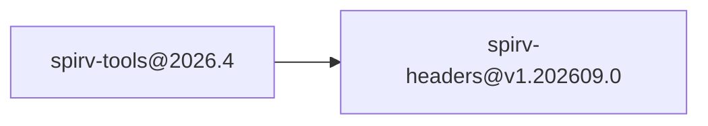

# spirv-tools 2026.4: BuildEngine integration

## DLL import-library installation contract (16 November 2026)

The installed shared import library required by Skia's GN bridge is now explicitly named `libSPIRV-Tools-shared.lib` under `lib/win64/{Configuration}` according to the BCC64X CMake shared-library prefix convention. The producer's Release/Debug install phase must find that exact file, instead of accepting an otherwise empty library directory. Skia performs an independent preflight before GN generation.

**[not verified]** The Windows-host producer output still needs to confirm this exact filename. If the actual output differs, correct the producer naming contract and then the consumer declaration together rather than disguising a missing artifact.

## Skia 153 Debug consumer link failure (16 November 2026)

The operator-reported no-change Skia 153 Debug run failed because the consumer expected `lib/win64/Debug/SPIRV-Tools-shared.lib` at this package's installed root. The linker could not open the file. This is a missing expected import artifact, not evidence of a C++ compile or shader validation error. Check the actual generated Debug import-library name and installation directory from the producer build before updating the consumer contract. Keep the managed DLL architecture and Debug validation enabled. The independently registered producer and the successful historical overall run do not prove that this exact Debug import path exists. **[not verified]** End-to-end Skia Debug consumer linking after correction.

[TOC|Content]

## Purpose and current integration

SPIR-V assembler, validator, optimizer and associated libraries

**BuildEngine package:** `spirv-tools@2026.4`  
**Upstream source reference:** `v2026.4`  
**Status:** Successful completion of the 109/109 BuildEngine integration run was confirmed on 15 November 2026. This is not a claim that Skia's separately bundled upstream copies have been replaced by the corresponding external packages.

## Direct and transitive dependencies

- `spirv-headers@v1.202609.0`



The graph follows the version-specific BuildEngine XML dependency declarations. Shared dependencies are shown once. It does not infer binary linkage from the presence of a package in the overall closure.

## Build configuration

**Toolchain:** Windows x64, RAD Studio C++Builder BCC64X, CMake/Ninja where configured. BuildEngine injects the paths and versions from its dependency and tool registries; no machine-specific absolute path is part of this guide.

```text
-DCMAKE_TOOLCHAIN_FILE:FILEPATH={BuildFileDir}\cmake\toolchains\bcc64x-buildengine-cxx.cmake
-DCMAKE_MAKE_PROGRAM:FILEPATH={Tool:ninja}
-DCMAKE_INSTALL_PREFIX:PATH={InstallRoot}\packages\{LibraryId}\{LibraryVersion}
-DCMAKE_INSTALL_INCLUDEDIR:STRING=include
-DCMAKE_INSTALL_LIBDIR:STRING=lib/win64/{Configuration}
-DCMAKE_INSTALL_BINDIR:STRING=bin/win64/{Configuration}
-DSPIRV-Headers_DIR:PATH={DependencyRoot:spirv-headers}\share\cmake\SPIRV-Headers
-DSPIRV_SKIP_TESTS:BOOL=ON
-DSPIRV_SKIP_EXECUTABLES:BOOL=ON
-DSPIRV_WERROR:BOOL=OFF
-DSPIRV_TOOLS_USE_MIMALLOC:BOOL=OFF
-DSPIRV_TOOLS_BUILD_STATIC:BOOL=OFF
-DBUILD_SHARED_LIBS:BOOL=ON
-DENABLE_SPIRV_TOOLS_INSTALL:BOOL=ON
-DPython3_EXECUTABLE:FILEPATH={Tool:python}
-DCMAKE_BUILD_TYPE:STRING=Release
-DCMAKE_BUILD_TYPE:STRING=Debug
```

## Integration patches and special considerations

No version-specific source patch is declared in the source workflow.

SPIRV-Headers is resolved from its separately installed BuildEngine package through the configured CMake package directory.


## Verification and maintenance

The overall BuildEngine run was reported successful for 109 versioned library integrations. Check each package's installed artifacts and its package-specific logs for per-configuration and consumer-test evidence. The authoritative configuration is `admin/build-libraries.xml`; do not duplicate dependency paths or names as fixed values outside its variables.

[Library overview](/manual/libraries.md)
