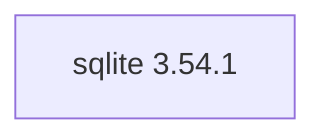

## Updated BuildEngine contract (10 November 2026)

**Declared configuration; no new test PASS.**

### Complete transitive dependencies

Direct: none

### Current configuration

- `-DSQLITE_SOURCE_DIR:PATH={Workspace}`
- `-DBCC64X_EXECUTABLE:FILEPATH={Tool:bcc64x}`
- `-DCMAKE_INSTALL_PREFIX:PATH={BuildRoot}\stage\packages\{LibraryId}\{LibraryVersion}\{Configuration}`
- `-DCMAKE_INSTALL_LIBDIR:STRING=lib\win64\{Configuration}`
- `-DCMAKE_INSTALL_BINDIR:STRING=bin\win64\{Configuration}`
- `-DCMAKE_BUILD_TYPE:STRING=Release`
- `-DCMAKE_BUILD_TYPE:STRING=Debug`

---

## Historical integration notes

# SQLite 3.54.1

[TOC|Content]

## Current BuildEngine contract (10 November 2026)

**Contract data, not verified build execution.** Earlier test results apply only to exact versions and builds; new runs remain **[not verified]**.

Embedded relational database engine providing a self-contained SQL database in a single library.

**Coordinate:** `sqlite@3.54.1` · **Category:** `database` · **License indicator:** `green`

### Declared dependencies (full transitive closure)

Edges come from exactly pinned XML dependencies. Dashed edges denote extensions, solid edges package dependencies. Bundled upstream components are not additional BuildEngine coordinates.

**Direct dependencies:** None declared.

### Configuration and integration notes

**CMake arguments:**

- `-DSQLITE_SOURCE_DIR:PATH={Workspace}`
- `-DBCC64X_EXECUTABLE:FILEPATH={Tool:bcc64x}`
- `-DCMAKE_INSTALL_PREFIX:PATH={BuildRoot}\stage\packages\{LibraryId}\{LibraryVersion}\{Configuration}`
- `-DCMAKE_INSTALL_LIBDIR:STRING=lib\win64\{Configuration}`
- `-DCMAKE_INSTALL_BINDIR:STRING=bin\win64\{Configuration}`
- `-DCMAKE_BUILD_TYPE:STRING=Release`
- `-DCMAKE_BUILD_TYPE:STRING=Debug`

**Source-Downloads:**

- `https://www.sqlite.org/2026/sqlite-amalgamation-3540100.zip` (SHA-256: `0a9c8e34352dad46006aa82836d5383bff9dc6bc9ce5a60553c05aa30e6ad1f9`)

**Deklarierte Smoke-Tests:**

- `consumer` / `Release` / `published` / `smokes\sqlite\consumer`

**Explizit geforderte Installationsartefakte:**

- `{InstallRoot}\packages\{LibraryId}\{LibraryVersion}\bin\win64\{Configuration}\{BaseName}.dll`
- `{InstallRoot}\packages\{LibraryId}\{LibraryVersion}\lib\win64\{Configuration}\{BaseName}.lib`

**Verbindliche Sources:** `admin/build-libraries.xml` for configuration and pins; FSM/build logs for actual execution. [Library catalog](/manual/libraries.md).
