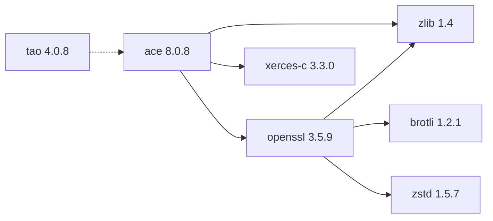

# TAO 4.0.8

[TOC|Content]

## Aktueller BuildEngine-Vertrag (10. November 2026)

**Vertragsdaten, keine bestätigte Build-Ausführung.** Ergebnisse aus früheren Tests sind versions- und buildgebunden; neue Ausführungen bleiben **[nicht verifiziert]**.

CORBA object request broker and middleware services built on top of ACE.

**Koordinate:** `tao@4.0.8` · **Kategorie:** `middleware` · **Lizenzampel:** `green`

### Deklarierte Abhängigkeiten (vollständig transitiv)

Die Diagrammkanten stammen aus den exakt gepinnten XML-Abhängigkeiten. Gestrichelte Kanten kennzeichnen Erweiterungen, durchgezogene Kanten Paketabhängigkeiten. Upstream-intern gebündelte Komponenten sind keine zusätzlichen BuildEngine-Koordinaten.

**Direkte Abhängigkeiten:** `ace@8.0.8` (Erweiterung)

### Konfiguration und Besonderheiten

**CMake-Argumente:**

- `-D{BMakeConfiguration}`

**Build-Umgebung:**

- `ACE_ROOT={ExtensionProducerRoot}`
- `TAO_ROOT={ExtensionProducerRoot}\TAO`
- `SSL_ROOT={DependencyRoot:openssl}`
- `SSL_INCDIR={DependencyRoot:openssl}\include`
- `SSL_LIBDIR={DependencyRoot:openssl}\lib\win64\{Configuration}`
- `XERCESC_INCDIR={DependencyRoot:xerces-c}\include`
- `XERCESC_LIBDIR={DependencyRoot:xerces-c}\lib\win64\{Configuration}`
- `XERCESLIB={XercesLibrary}`
- `ZLIB_ROOT={DependencyRoot:zlib}`
- `ZLIB_INCDIR={DependencyRoot:zlib}\include`
- `ZLIB_LIBDIR={DependencyRoot:zlib}\lib\win64\{Configuration}`
- `BCC32C=`
- `BCC64=`
- `BCC64X=1`
- `MPC_NUMBER_OF_PROCESSORS={BuildJobs}`
- `CODEGUARD=`
- `UNICODE=`
- `DEBUG={DebugFlag}`
- `RELEASE={ReleaseFlag}`
- `PATH={ExtensionProducerRoot}\lib;{ExtensionProducerRoot}\bin;{DependencyRoot:openssl}\bin\win64\{Configuration};{DependencyRoot:xerces-c}\bin\win64\{Configuration};{DependencyRoot:zlib}\bin\win64\{Configuration};{ToolDir:perl};{ToolDir:bcc64x};{ToolDir:embarcadero-make};{ENV:PATH}`

**Deklarierte Smoke-Tests:**

- `consumer` / `Release` / `package` / `smokes\ace-tao\consumer`

**Explizit geforderte Installationsartefakte:**

- `{ExtensionInstallRoot}\tools\bin\win64\{Configuration}\tao_idl.exe`
- `{ExtensionInstallRoot}\services\bin\win64\{Configuration}\tao_cosnaming.exe`
- `{ExtensionInstallRoot}\services\bin\win64\{Configuration}\tao_cosevent.exe`
- `{ExtensionInstallRoot}\services\bin\win64\{Configuration}\tao_rtevent.exe`
- `{ExtensionInstallRoot}\include\tao`
- `{ExtensionInstallRoot}\include\orbsvcs`
- `{ExtensionInstallRoot}\include\tao\corba.h`
- `{ExtensionInstallRoot}\include\orbsvcs\CosNamingC.h`
- `{ExtensionInstallRoot}\TAO_VERSION.txt`
- `{ExtensionInstallRoot}\.buildengine\extensions\{LibraryId}\{LibraryVersion}\COPYING`

**Verbindliche Quellen:** `admin/build-libraries.xml` für Konfiguration und Pins; FSM/Buildlogs für tatsächliche Ausführung. [Bibliotheksverzeichnis](/manual/libraries.md).
