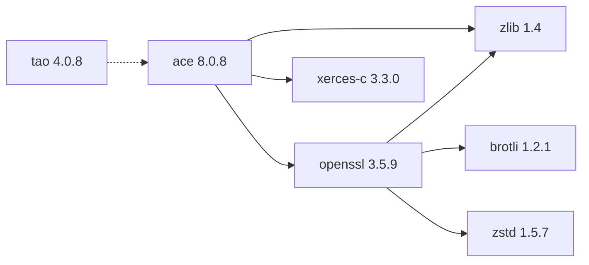

# TAO 4.0.8

[TOC|Content]

## Current BuildEngine contract (10 November 2026)

**Contract data, not verified build execution.** Earlier test results apply only to exact versions and builds; new runs remain **[not verified]**.

CORBA object request broker and middleware services built on top of ACE.

**Coordinate:** `tao@4.0.8` · **Category:** `middleware` · **License indicator:** `green`

### Declared dependencies (full transitive closure)

Edges come from exactly pinned XML dependencies. Dashed edges denote extensions, solid edges package dependencies. Bundled upstream components are not additional BuildEngine coordinates.

**Direct dependencies:** `ace@8.0.8` (Erweiterung)

### Configuration and integration notes

**CMake arguments:**

- `-D{BMakeConfiguration}`

**Build environment:**

- `ACE_ROOT={ExtensionProducerRoot}`
- `TAO_ROOT={ExtensionProducerRoot}\TAO`
- `SSL_ROOT={DependencyRoot:openssl}`
- `SSL_INCDIR={DependencyRoot:openssl}\include`
- `SSL_LIBDIR={DependencyRoot:openssl}\lib\win64\{Configuration}`
- `XERCESC_INCDIR={DependencyRoot:xerces-c}\include`
- `XERCESC_LIBDIR={DependencyRoot:xerces-c}\lib\win64\{Configuration}`
- `XERCESLIB={XercesLibrary}`
- `ZLIB_ROOT={DependencyRoot:zlib}`
- `ZLIB_INCDIR={DependencyRoot:zlib}\include`
- `ZLIB_LIBDIR={DependencyRoot:zlib}\lib\win64\{Configuration}`
- `BCC32C=`
- `BCC64=`
- `BCC64X=1`
- `MPC_NUMBER_OF_PROCESSORS={BuildJobs}`
- `CODEGUARD=`
- `UNICODE=`
- `DEBUG={DebugFlag}`
- `RELEASE={ReleaseFlag}`
- `PATH={ExtensionProducerRoot}\lib;{ExtensionProducerRoot}\bin;{DependencyRoot:openssl}\bin\win64\{Configuration};{DependencyRoot:xerces-c}\bin\win64\{Configuration};{DependencyRoot:zlib}\bin\win64\{Configuration};{ToolDir:perl};{ToolDir:bcc64x};{ToolDir:embarcadero-make};{ENV:PATH}`

**Deklarierte Smoke-Tests:**

- `consumer` / `Release` / `package` / `smokes\ace-tao\consumer`

**Explizit geforderte Installationsartefakte:**

- `{ExtensionInstallRoot}\tools\bin\win64\{Configuration}\tao_idl.exe`
- `{ExtensionInstallRoot}\services\bin\win64\{Configuration}\tao_cosnaming.exe`
- `{ExtensionInstallRoot}\services\bin\win64\{Configuration}\tao_cosevent.exe`
- `{ExtensionInstallRoot}\services\bin\win64\{Configuration}\tao_rtevent.exe`
- `{ExtensionInstallRoot}\include\tao`
- `{ExtensionInstallRoot}\include\orbsvcs`
- `{ExtensionInstallRoot}\include\tao\corba.h`
- `{ExtensionInstallRoot}\include\orbsvcs\CosNamingC.h`
- `{ExtensionInstallRoot}\TAO_VERSION.txt`
- `{ExtensionInstallRoot}\.buildengine\extensions\{LibraryId}\{LibraryVersion}\COPYING`

**Verbindliche Sources:** `admin/build-libraries.xml` for configuration and pins; FSM/build logs for actual execution. [Library catalog](/manual/libraries.md).
