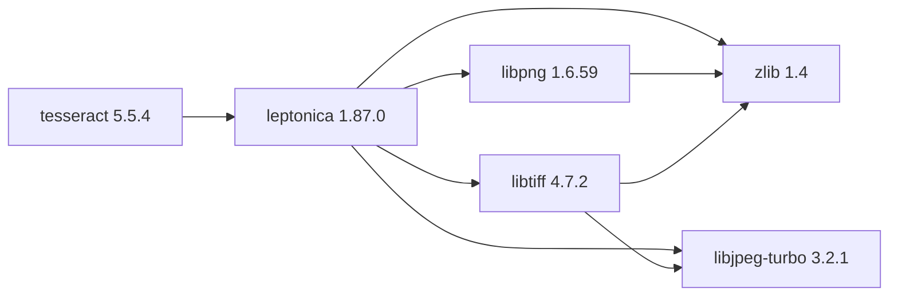

## Updated BuildEngine contract (10 November 2026)

**Declared configuration; no new test PASS.**

### Complete transitive dependencies

Direkt: `leptonica@1.87.0`

### Current configuration

- `-DCMAKE_TOOLCHAIN_FILE:FILEPATH={BuildFileDir}\cmake\toolchains\bcc64x-buildengine-cxx.cmake`
- `-DCMAKE_MAKE_PROGRAM:FILEPATH={Tool:ninja}`
- `-DCMAKE_INSTALL_PREFIX:PATH={InstallRoot}\packages\{LibraryId}\{LibraryVersion}`
- `-DCMAKE_INSTALL_BINDIR:STRING=bin/win64/{Configuration}`
- `-DBUILD_SHARED_LIBS:BOOL=ON`
- `-DBUILD_TRAINING_TOOLS:BOOL=OFF`
- `-DBUILD_TESTS:BOOL=OFF`
- `-DOPENMP_BUILD:BOOL=OFF`
- `-DENABLE_NATIVE:BOOL=OFF`
- `-DENABLE_PRECOMPILED_HEADERS:BOOL=OFF`
- `-DENABLE_CCACHE:BOOL=OFF`
- `-DDISABLE_TIFF:BOOL=ON`
- `-DDISABLE_ARCHIVE:BOOL=ON`
- `-DDISABLE_CURL:BOOL=ON`
- `-DLeptonica_DIR:PATH={DependencyRoot:leptonica}\lib\win64\{Configuration}\cmake\leptonica`
- `-DCMAKE_PREFIX_PATH:PATH={DependencyRoot:leptonica}`
- `-DCMAKE_BUILD_TYPE:STRING=Release`
- `-DCMAKE_CXX_FLAGS_RELEASE:STRING=-O2 -DNDEBUG`
- `-DCMAKE_INSTALL_LIBDIR:STRING=lib/win64/Release`
- `-DCMAKE_BUILD_TYPE:STRING=Debug`
- `-DCMAKE_CXX_FLAGS_DEBUG:STRING=-O0`
- `-DCMAKE_INSTALL_LIBDIR:STRING=lib/win64/Debug`
- `-DLeptonica_DIR:PATH={DependencyRoot:leptonica}\lib\win64\Release\cmake\leptonica`
- `-DTesseract_DIR:PATH={InstallRoot}\packages\{LibraryId}\{LibraryVersion}\lib\win64\Release\cmake\tesseract`
- `-DLeptonica_DIR:PATH={DependencyRoot:leptonica}\lib\win64\Release\cmake\leptonica`
- `-DTesseract_DIR:PATH={InstallRoot}\packages\{LibraryId}\{LibraryVersion}\lib\win64\Release\cmake\tesseract`
- `-DOCR_TESSDATA_DIRECTORY:PATH={InstallRoot}\packages\{LibraryId}\{LibraryVersion}\share\tessdata`

---

## Historical integration notes

# Tesseract OCR 5.5.4

[TOC|Content]

## Current BuildEngine contract (10 November 2026)

**Contract data, not verified build execution.** Earlier test results apply only to exact versions and builds; new runs remain **[not verified]**.

Dynamically linked C++ OCR engine; language traineddata is provisioned and licensed separately.

**Coordinate:** `tesseract@5.5.4` · **Category:** `text` · **License indicator:** `yellow`

### Declared dependencies (full transitive closure)

Edges come from exactly pinned XML dependencies. Dashed edges denote extensions, solid edges package dependencies. Bundled upstream components are not additional BuildEngine coordinates.

**Direct dependencies:** `leptonica@1.87.0`

### Configuration and integration notes

**CMake arguments:**

- `-DCMAKE_TOOLCHAIN_FILE:FILEPATH={BuildFileDir}\cmake\toolchains\bcc64x-buildengine-cxx.cmake`
- `-DCMAKE_MAKE_PROGRAM:FILEPATH={Tool:ninja}`
- `-DCMAKE_INSTALL_PREFIX:PATH={InstallRoot}\packages\{LibraryId}\{LibraryVersion}`
- `-DCMAKE_INSTALL_BINDIR:STRING=bin/win64/{Configuration}`
- `-DBUILD_SHARED_LIBS:BOOL=ON`
- `-DBUILD_TRAINING_TOOLS:BOOL=OFF`
- `-DBUILD_TESTS:BOOL=OFF`
- `-DOPENMP_BUILD:BOOL=OFF`
- `-DENABLE_NATIVE:BOOL=OFF`
- `-DENABLE_PRECOMPILED_HEADERS:BOOL=OFF`
- `-DENABLE_CCACHE:BOOL=OFF`
- `-DDISABLE_TIFF:BOOL=ON`
- `-DDISABLE_ARCHIVE:BOOL=ON`
- `-DDISABLE_CURL:BOOL=ON`
- `-DLeptonica_DIR:PATH={DependencyRoot:leptonica}\lib\win64\{Configuration}\cmake\leptonica`
- `-DCMAKE_PREFIX_PATH:PATH={DependencyRoot:leptonica}`
- `-DCMAKE_BUILD_TYPE:STRING=Release`
- `-DCMAKE_CXX_FLAGS_RELEASE:STRING=-O2 -DNDEBUG`
- `-DCMAKE_INSTALL_LIBDIR:STRING=lib/win64/Release`
- `-DCMAKE_BUILD_TYPE:STRING=Debug`
- `-DCMAKE_CXX_FLAGS_DEBUG:STRING=-O0`
- `-DCMAKE_INSTALL_LIBDIR:STRING=lib/win64/Debug`

**Build environment:**

- `CB_BCC64X={Tool:bcc64x}`
- `CB_BDS={BDS}`

**Versionsgebundene Patches:**

- `{Workspace}\.buildengine\patches\bcc64x-runtime-install.patch`
- `{BuildFileDir}\patches\tesseract\5.5.4\bcc64x-runtime-install.patch`

**Source-Downloads:**

- `https://github.com/tesseract-ocr/tesseract/archive/7e548e6eff172f38f97664afe7f7ce40db36c8d6.zip`
- `https://raw.githubusercontent.com/tesseract-ocr/tessdata_fast/87416418657359cb625c412a48b6e1d6d41c29bd/eng.traineddata` (SHA-256: `7d4322bd2a7749724879683fc3912cb542f19906c83bcc1a52132556427170b2`)

**Deklarierte Smoke-Tests:**

- `consumer` / `Release` / `package` / `smokes\tesseract\consumer`
- `ocr` / `Release` / `package` / `smokes\tesseract\ocr`

**Explizit geforderte Installationsartefakte:**

- `{InstallRoot}\packages\{LibraryId}\{LibraryVersion}\lib\win64\{Configuration}\cmake\tesseract\TesseractConfig.cmake`
- `{InstallRoot}\packages\{LibraryId}\{LibraryVersion}\bin\win64\{Configuration}`
- `{InstallRoot}\packages\{LibraryId}\{LibraryVersion}\include\tesseract\baseapi.h`
- `{InstallRoot}\packages\{LibraryId}\{LibraryVersion}\share\tessdata\eng.traineddata`

**Verbindliche Sources:** `admin/build-libraries.xml` for configuration and pins; FSM/build logs for actual execution. [Library catalog](/manual/libraries.md).
