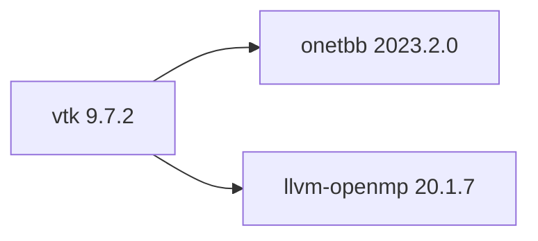

## Aktualisierter BuildEngine-Vertrag (10. November 2026)

**Deklarierte Konfiguration, nicht neuer Test-PASS.**

### Vollständige transitive Abhängigkeiten



Direkt: `onetbb@2023.2.0`, `llvm-openmp@20.1.7`

### Aktuelle Konfiguration

- `-DCMAKE_TOOLCHAIN_FILE:FILEPATH={BuildFileDir}\cmake\toolchains\bcc64x-buildengine-cxx.cmake`
- `-DCMAKE_MAKE_PROGRAM:FILEPATH={Tool:ninja}`
- `-DCMAKE_INSTALL_PREFIX:PATH={BuildRoot}\stage\packages\{LibraryId}\{LibraryVersion}\{Configuration}`
- `-DCMAKE_INSTALL_INCLUDEDIR:STRING=include`
- `-DCMAKE_INSTALL_LIBDIR:STRING=lib/win64/{Configuration}`
- `-DCMAKE_INSTALL_BINDIR:STRING=bin/win64/{Configuration}`
- `-DBUILD_SHARED_LIBS:BOOL=ON`
- `-DVTK_BUILD_TESTING:BOOL=OFF`
- `-DVTK_USE_PCH:BOOL=OFF`
- `-DVTK_GROUP_ENABLE_StandAlone:STRING=DONT_WANT`
- `-DVTK_GROUP_ENABLE_Rendering:STRING=DONT_WANT`
- `-DVTK_GROUP_ENABLE_Web:STRING=DONT_WANT`
- `-DVTK_GROUP_ENABLE_MPI:STRING=DONT_WANT`
- `-DVTK_MODULE_ENABLE_VTK_CommonCore:STRING=YES`
- `-DVTK_MODULE_ENABLE_VTK_CommonDataModel:STRING=YES`
- `-DVTK_MODULE_ENABLE_VTK_FiltersCore:STRING=YES`
- `-DVTK_SMP_IMPLEMENTATION_TYPE:STRING=TBB`
- `-DVTK_SMP_ENABLE_TBB:BOOL=ON`
- `-DVTK_SMP_ENABLE_OPENMP:BOOL=ON`
- `-DTBB_DIR:PATH={DependencyRoot:onetbb}\lib\win64\{Configuration}\cmake\TBB`
- `-DCMAKE_PREFIX_PATH:PATH={DependencyRoot:onetbb}`
- `-DOpenMP_CXX_FLAGS:STRING=-fopenmp`
- `-DOpenMP_CXX_LIB_NAMES:STRING=omp`
- `-DOpenMP_omp_LIBRARY:FILEPATH={DependencyRoot:llvm-openmp}\lib\win64\{Configuration}\libomp.lib`
- `-DVTK_WRAP_PYTHON:BOOL=OFF`
- `-DVTK_WRAP_JAVA:BOOL=OFF`
- `-DCMAKE_BUILD_TYPE:STRING=Release`
- `-DCMAKE_C_FLAGS_RELEASE:STRING=-O2 -DNDEBUG`
- `-DCMAKE_CXX_FLAGS_RELEASE:STRING=-O2 -DNDEBUG`
- `-DCMAKE_BUILD_TYPE:STRING=Debug`
- `-DCMAKE_C_FLAGS_DEBUG:STRING=-O0`
- `-DCMAKE_CXX_FLAGS_DEBUG:STRING=-O0`
- `-DVTK_DIR:PATH={InstallRoot}\packages\{LibraryId}\{LibraryVersion}\lib\win64\{Configuration}\cmake\vtk-9.7`
- `-DVTK_DIR:PATH={InstallRoot}\packages\{LibraryId}\{LibraryVersion}\lib\win64\{Configuration}\cmake\vtk-9.7`

---

## Historische Integrationsnotizen

# vtk 9.7.2: BCC64X migration and integration record

[TOC|Content]

**Contract identity:** `vtk@9.7.2` · **Category:** graphics · **Target:** RAD Studio 13 Florence / BCC64X 20.1.7 / Windows x64.

**Verification boundary:** Registration in `admin/build-libraries.xml` is not evidence of successful compilation, installation or consumer execution. All Windows-specific outcomes below remain **[not verified]** until the BuildEngine FSM and logs report them.

## Source provenance

- Official release: VTK 9.7.2 (Kitware, November 5, 2026).
- Release download: `https://vtk.org/files/release/9.7/VTK-9.7.2.tar.gz`.
- Official SHA-256: `fecef55df5caec6298ce190024060a90ce3bb515033c0f18968b9ab5c12bf796`.
- Release tag: `v9.7.2`; corresponding commit `0558d4d4e4bc86c4b4bf7af2f2488011a4de9e0f`.
- Extracted root: `VTK-9.7.2`; required: `CMakeLists.txt`, `Copyright.txt`, `Common/Core/vtkVersion.h`, `Common/DataModel/CMakeLists.txt`, `Filters/Core/CMakeLists.txt`.

## Integration intent

VTK 9.7.2 is a parallel, separately versioned BuildEngine library. VTK 9.6.2 stays unmodified and is **not** marked superseded until the 9.7.2 Release and Debug variants and consumers pass.

The initial module boundary remains `VTK::CommonCore`, `VTK::CommonDataModel` and `VTK::FiltersCore`; `VTK::CommonCache` is a newly introduced private dependency of `VTK::FiltersCore` in upstream 9.7.2. No additional rendering, web, MPI or language wrapping is enabled.

## Direct BuildEngine dependencies

| Library | Version | Usage |
| --- | --- | --- |
| onetbb | 2023.2.0 | VTK native TBB SMP backend |
| llvm-openmp | 20.1.7 | VTK native OpenMP SMP backend |

VTK may build additional bundled third-party components through its own CMake module graph. These are not independent BuildEngine package dependencies in this profile.

## Build flags

```cmake
-DBUILD_SHARED_LIBS:BOOL=ON
-DVTK_USE_PCH:BOOL=OFF
-DVTK_BUILD_TESTING:BOOL=OFF
-DVTK_GROUP_ENABLE_StandAlone:STRING=DONT_WANT
-DVTK_GROUP_ENABLE_Rendering:STRING=DONT_WANT
-DVTK_GROUP_ENABLE_Web:STRING=DONT_WANT
-DVTK_GROUP_ENABLE_MPI:STRING=DONT_WANT
-DVTK_MODULE_ENABLE_VTK_CommonCore:STRING=YES
-DVTK_MODULE_ENABLE_VTK_CommonDataModel:STRING=YES
-DVTK_MODULE_ENABLE_VTK_FiltersCore:STRING=YES
-DVTK_SMP_IMPLEMENTATION_TYPE:STRING=TBB
-DVTK_SMP_ENABLE_TBB:BOOL=ON
-DVTK_SMP_ENABLE_OPENMP:BOOL=ON
-DVTK_WRAP_PYTHON:BOOL=OFF
-DVTK_WRAP_JAVA:BOOL=OFF
```

The version-specific PCH setting avoids introducing a new compiler-compatibility variable during the initial BCC64X upgrade. The project CMake minimum requirement and SMP selection module remain compatible with the existing CMake 4.1.1 / oneTBB / OpenMP contract by source inspection; actual configuration is **[not verified]**.

## Expected installed artifacts

The existing versioned installation and Debug postfix conventions predict:

| Module | Release DLL | Debug DLL |
| --- | --- | --- |
| CommonCore | `libvtkCommonCore-9.7.dll` | `libvtkCommonCore-9.7d.dll` |
| CommonDataModel | `libvtkCommonDataModel-9.7.dll` | `libvtkCommonDataModel-9.7d.dll` |
| FiltersCore | `libvtkFiltersCore-9.7.dll` | `libvtkFiltersCore-9.7d.dll` |
| CommonCache | `libvtkCommonCache-9.7.dll` | `libvtkCommonCache-9.7d.dll` |

Import libraries have the corresponding `.lib` names. Install validation requires each expected file. Shared headers are installed under `include/vtk-9.7`.

## Consumer verification

Source: `admin/smokes/vtk/9.7.2/consumer`. Separate `scope=package` smokes for **Release** and **Debug** use the installed version 9.7.2 and transitive runtime dependency closure.

Checks:

1. `find_package(VTK 9.7.2 EXACT CONFIG REQUIRED COMPONENTS CommonCore CommonDataModel FiltersCore CommonCache)`.
2. Imported target linking and a two-point `vtkElevationFilter` pipeline.
3. Instantiate `vtkDataObjectMeshCache` and invoke its class metadata.
4. `VTK_SMP_ENABLE_TBB` and `VTK_SMP_ENABLE_OPENMP` are both set.
5. Runtime version is exactly `9.7.2`.

The smoke emits `SMOKE|CHECK` lines and a single `SMOKE|RESULT` line; nonzero return on any failed check.

## Evidence gates

| Gate | Evidence |
| --- | --- |
| Source tag and archive checksum | Official release metadata inspected |
| XML coordinate and source pin | Registered, SHA-256 configured |
| Release compilation and DLLs | [not verified] |
| Debug compilation and DLLs | [not verified] |
| Runtime TBB + OpenMP | [not verified] |
| Installed package smoke: Release | [not verified] |
| Installed package smoke: Debug | [not verified] |
| Metadata / SBOM | [not verified] |
| Supersession of 9.6.2 | Not performed |

**Do not report PASS without an actual corresponding BuildEngine log.**

## Maintained references

- `admin/build-libraries.xml`
- `admin/smokes/vtk/9.7.2/consumer/CMakeLists.txt`
- `admin/smokes/vtk/9.7.2/consumer/main.cpp`
- Upstream VTK `v9.7.2`: `Common/Core/vtk.module`, `Common/DataModel/vtk.module`, `Common/Cache/vtk.module`, `Filters/Core/vtk.module`, `CMake/vtkModule.cmake`.
