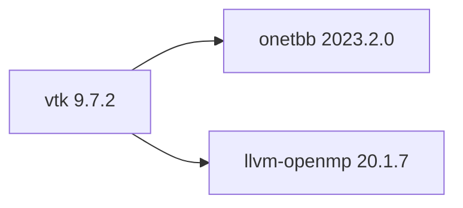

## Updated BuildEngine contract (10 November 2026)

**Declared configuration; no new test PASS.**

### Complete transitive dependencies



Direct: `onetbb@2023.2.0`, `llvm-openmp@20.1.7`

### Current configuration

- `-DCMAKE_TOOLCHAIN_FILE:FILEPATH={BuildFileDir}\cmake\toolchains\bcc64x-buildengine-cxx.cmake`
- `-DCMAKE_MAKE_PROGRAM:FILEPATH={Tool:ninja}`
- `-DCMAKE_INSTALL_PREFIX:PATH={BuildRoot}\stage\packages\{LibraryId}\{LibraryVersion}\{Configuration}`
- `-DCMAKE_INSTALL_INCLUDEDIR:STRING=include`
- `-DCMAKE_INSTALL_LIBDIR:STRING=lib/win64/{Configuration}`
- `-DCMAKE_INSTALL_BINDIR:STRING=bin/win64/{Configuration}`
- `-DBUILD_SHARED_LIBS:BOOL=ON`
- `-DVTK_BUILD_TESTING:BOOL=OFF`
- `-DVTK_USE_PCH:BOOL=OFF`
- `-DVTK_GROUP_ENABLE_StandAlone:STRING=DONT_WANT`
- `-DVTK_GROUP_ENABLE_Rendering:STRING=DONT_WANT`
- `-DVTK_GROUP_ENABLE_Web:STRING=DONT_WANT`
- `-DVTK_GROUP_ENABLE_MPI:STRING=DONT_WANT`
- `-DVTK_MODULE_ENABLE_VTK_CommonCore:STRING=YES`
- `-DVTK_MODULE_ENABLE_VTK_CommonDataModel:STRING=YES`
- `-DVTK_MODULE_ENABLE_VTK_FiltersCore:STRING=YES`
- `-DVTK_SMP_IMPLEMENTATION_TYPE:STRING=TBB`
- `-DVTK_SMP_ENABLE_TBB:BOOL=ON`
- `-DVTK_SMP_ENABLE_OPENMP:BOOL=ON`
- `-DTBB_DIR:PATH={DependencyRoot:onetbb}\lib\win64\{Configuration}\cmake\TBB`
- `-DCMAKE_PREFIX_PATH:PATH={DependencyRoot:onetbb}`
- `-DOpenMP_CXX_FLAGS:STRING=-fopenmp`
- `-DOpenMP_CXX_LIB_NAMES:STRING=omp`
- `-DOpenMP_omp_LIBRARY:FILEPATH={DependencyRoot:llvm-openmp}\lib\win64\{Configuration}\libomp.lib`
- `-DVTK_WRAP_PYTHON:BOOL=OFF`
- `-DVTK_WRAP_JAVA:BOOL=OFF`
- `-DCMAKE_BUILD_TYPE:STRING=Release`
- `-DCMAKE_C_FLAGS_RELEASE:STRING=-O2 -DNDEBUG`
- `-DCMAKE_CXX_FLAGS_RELEASE:STRING=-O2 -DNDEBUG`
- `-DCMAKE_BUILD_TYPE:STRING=Debug`
- `-DCMAKE_C_FLAGS_DEBUG:STRING=-O0`
- `-DCMAKE_CXX_FLAGS_DEBUG:STRING=-O0`
- `-DVTK_DIR:PATH={InstallRoot}\packages\{LibraryId}\{LibraryVersion}\lib\win64\{Configuration}\cmake\vtk-9.7`
- `-DVTK_DIR:PATH={InstallRoot}\packages\{LibraryId}\{LibraryVersion}\lib\win64\{Configuration}\cmake\vtk-9.7`

---

## 10 November 2026 — Installed consumer CMake dependency discovery

The installed VTK 9.7.2 Release consumer reached CMake configuration but failed before building: the exported `vtk-9.7/FindTBB.cmake` reported `Could NOT find TBB (missing: TBB_DIR)` and `Required library TBB not found`. The smoke already supplied `VTK_DIR` and managed dependency roots in `CMAKE_PREFIX_PATH`, but the oneTBB package uses the configuration-specific `lib/win64/<Configuration>/cmake/TBB` directory rather than an ordinary default CMake package layout. VTK's own producer configuration and the oneTBB consumer already specify this exact `TBB_DIR` path.

Both VTK 9.7.2 package smokes (Release and Debug) now pass the managed `TBB_DIR` using `{DependencyRoot:onetbb}` and `{Configuration}`. They also forward the same OpenMP C++ discovery settings as the VTK producer (`OpenMP_CXX_FLAGS=-fopenmp`, `OpenMP_CXX_LIB_NAMES=omp`, and `OpenMP_omp_LIBRARY` pointing to the matching `llvm-openmp` runtime). No installed package, compiler, library source, module selection, or global CMake search path is changed.

**Scope evidence:** This is a smoke-only configuration fix. The library revision timestamp is intentionally unchanged so completed VTK source/build/install work can be reused; the failed consumer smoke has no successful completion evidence and is eligible for retry. The updated Release/Debug smoke outcome is **[not verified]** until the Windows run completes.

## 10 November 2026 — OpenGL2 and volume-rendering expansion

The BuildEngine 9.7.2 profile was expanded from a headless-only core subset to a genuine Windows WGL rendering profile. Enabled modules explicitly include `RenderingCore`, `RenderingOpenGL2`, `RenderingFreeType`, `RenderingVolume`, `RenderingVolumeOpenGL2`, `RenderingAnnotation`, `InteractionStyle`, `FiltersSources`, `IOImage` and `ImagingCore`. Required companion modules are resolved through VTK's native module dependency graph, while Web, MPI, and unnecessary full-group enablement remain disabled.

Direct BuildEngine dependencies: `onetbb@2023.2.0`, `llvm-openmp@20.1.7`, `opengl@26.2.1`. The installed Mesa 26.2.1 package supplies a pinned Windows WGL OpenGL import library through `OPENGL_gl_LIBRARY`; it is a software-rasterizer distribution, **not proof of hardware-accelerated rendering**. VTK 9.7.2's OpenGL2 modules internally use GLAD, so GLEW is not a VTK producer dependency. For the native interactive application the locally deployed Mesa `opengl32.dll` must be excluded if the system ICD/GPU is intended; an explicit optional software-Mesa deployment remains available for diagnostics. No untracked SDK import library is introduced.

For both Debug and Release, installation now requires the OpenGL2, volume, interaction, PNG I/O, filtering, text, and annotation module DLLs and import libraries. Dedicated installed-package `rendering` smokes resolve the same exact oneTBB, OpenMP, OpenGL and VTK paths as the producer and validate construction and linkage of the rendering components without requiring a graphics desktop. The separate `BuildEngine-Tests/vtk-visualization` project covers actual interactive rendering, PNG capture, analytic surface validation, multiple SMP backends and configurable load tests.

The library revision timestamp advanced from `2026-11-10T02:11:05Z` to `2026-11-10T02:45:00Z` so the FSM rebuilds both variants with new module targets. All native BCC64X rendering/link/runtime results remain **[not verified]** until a Windows run and actual GPU screenshots are obtained.

## Historical integration notes

# vtk 9.7.2: BCC64X migration and integration record

[TOC|Content]

**Contract identity:** `vtk@9.7.2` · **Category:** graphics · **Target:** RAD Studio 13 Florence / BCC64X 20.1.7 / Windows x64.

**Verification boundary:** Registration in `admin/build-libraries.xml` is not evidence of successful compilation, installation or consumer execution. All Windows-specific outcomes below remain **[not verified]** until the BuildEngine FSM and logs report them.

## 10 November 2026 — BCC64X FastDownCast producer patch

**FSM source invalidation:** the library contract revision timestamp was advanced from `2026-11-10T00:31:00Z` to `2026-11-10T01:43:00Z`. The BuildEngine `ScopeStateStore` persists the library timestamp for each successful scope; `LibraryProgressEvaluator::ScopeCompletedAt` rejects older timestamps. This invalidates existing VTK 9.7.2 source, build and downstream evidence on the next run, allowing extraction and `git apply --check` / `git apply` to run before CMake configure/build for Release and Debug. No cache wipe or force rebuilding of unrelated libraries is required.


The VTK 9.7.2-specific source patch `admin/patches/vtk/9.7.2/bcc64x-fastdowncast-exports.patch` moves the `FastDownCast` definitions in `vtkAffineArray.h`, `vtkStructuredPointArray.h` and `vtkConstantArray.h` from the class body to out-of-class template definitions. The methods remain callable for other template arguments; explicit instantiation in `CommonCore` now sees an out-of-class definition rather than a class-body inline definition. The patch is applied at source preparation with `git apply --check` followed by `git apply`. No global warning suppression or compiler/runtime replacement is introduced.

The four previously unresolved `FastDownCast` instantiations are the regression target. The source-level change is committed, but rebuilt DLL export tables, import libraries and Release/Debug link results are **[not verified]** until the Windows BCC64X run completes. Inspect exports first and then confirm `CommonDataModel` and the package consumer for each configuration.

### 10 November 2026 — E4010 compiler correction

The initial out-of-class definition incorrectly replaced the declaration's dependent `ValueType` alias with the template parameter `ValueTypeT` in the return type. Native BCC64X rejected this with `E4010` while compiling `vtkArrayBulkInstantiate_vtkIdType.cxx` in both configurations. Preserve the exact declared return type through a trailing return type: `auto vtkAffineArray<ValueTypeT>::FastDownCast(vtkAbstractArray*) -> vtkAffineArray<ValueType>*` (and the same transformation for `vtkStructuredPointArray` and `vtkConstantArray`). The cast in the body uses `ValueType` as in the original upstream definition. An isolated C++23 test reproduces the initial Clang type-mismatch diagnostic and accepts the new form, including a Windows-target Clang syntax check. **Native BCC64X Release/Debug compilation and resulting DLL exports remain [not verified].**

The library revision was advanced from `2026-11-10T01:43:00Z` to `2026-11-10T02:11:05Z` to invalidate the completed source scope and force clean re-extraction and patch application. BuildEngine's extraction stage creates a new temporary tree and replaces the target tree, so previously patched headers do not persist into the new source scope.

## 10 November 2026 — Debug linker diagnosis

The native BCC64X Debug build compiled and linked numerous VTK modules successfully before the **589/835** link step failed for `libvtkCommonDataModel-9.7d.dll`. The link command used the expected **dynamic BCC64X runtime** (`-tR`) and the managed UCRT compatibility archive. The failure is isolated to four unresolved methods:

```text
vtkAffineArray<int>::FastDownCast(vtkAbstractArray*)
vtkAffineArray<long long>::FastDownCast(vtkAbstractArray*)
vtkStructuredPointArray<double>::FastDownCast(vtkAbstractArray*)
vtkConstantArray<unsigned char>::FastDownCast(vtkAbstractArray*)
```

These methods have inline definitions in their respective VTK 9.7.2 `Common/Core` headers, while the same template classes use extern-template declarations with `VTKCOMMONCORE_EXPORT`. VTK generates class template instantiations in `vtkArrayBulkInstantiate_<type>.cxx` and provides them through `vtkCommonCore`. The evidence is consistent with the BCC64X compiler not emitting or exporting the four static inline instantiations expected by the `CommonDataModel` consumer. Confirm the exact producer symbol table before creating any patch.

The log contains **11,033 warnings**: `W6679` 10,949 (ignored `dllimport` on redeclared inline methods), `W6398` 78 (ignored import/export attributes on inline functions), `W6645` 5 (deprecated `GetVersionEx`) and `W6701` 1 (redundant equality parentheses in `vtkSocket.cxx`). Many arise repeatedly through common VTK header inclusion; they are not 11,033 independent defects.

**Recommended investigation:** inspect `libvtkCommonCore-9.7d.dll` exports and the corresponding import library for the four exact `FastDownCast` symbols. If absent, construct a minimal **VTK 9.7.2-specific** source patch that forces the required methods to be emitted from the `CommonCore` producer with correct DLL visibility; build the producer first, then relink `CommonDataModel` before proceeding to the remaining modules. Do not globally disable `-Wignored-attributes`, and do not switch away from BCC64X. This document records the diagnosis only; it does not introduce an untested upstream patch or alter BuildEngine XML.

## Source provenance

- Official release: VTK 9.7.2 (Kitware, November 5, 2026).
- Release download: `https://vtk.org/files/release/9.7/VTK-9.7.2.tar.gz`.
- Official SHA-256: `fecef55df5caec6298ce190024060a90ce3bb515033c0f18968b9ab5c12bf796`.
- Release tag: `v9.7.2`; corresponding commit `0558d4d4e4bc86c4b4bf7af2f2488011a4de9e0f`.
- Extracted root: `VTK-9.7.2`; required: `CMakeLists.txt`, `Copyright.txt`, `Common/Core/vtkVersion.h`, `Common/DataModel/CMakeLists.txt`, `Filters/Core/CMakeLists.txt`.

## Integration intent

VTK 9.7.2 is a parallel, separately versioned BuildEngine library. VTK 9.6.2 stays unmodified and is **not** marked superseded until the 9.7.2 Release and Debug variants and consumers pass.

The initial module boundary remains `VTK::CommonCore`, `VTK::CommonDataModel` and `VTK::FiltersCore`; `VTK::CommonCache` is a newly introduced private dependency of `VTK::FiltersCore` in upstream 9.7.2. No additional rendering, web, MPI or language wrapping is enabled.

## Direct BuildEngine dependencies

| Library | Version | Usage |
| --- | --- | --- |
| onetbb | 2023.2.0 | VTK native TBB SMP backend |
| llvm-openmp | 20.1.7 | VTK native OpenMP SMP backend |

VTK may build additional bundled third-party components through its own CMake module graph. These are not independent BuildEngine package dependencies in this profile.

## Build flags

```cmake
-DBUILD_SHARED_LIBS:BOOL=ON
-DVTK_USE_PCH:BOOL=OFF
-DVTK_BUILD_TESTING:BOOL=OFF
-DVTK_GROUP_ENABLE_StandAlone:STRING=DONT_WANT
-DVTK_GROUP_ENABLE_Rendering:STRING=DONT_WANT
-DVTK_GROUP_ENABLE_Web:STRING=DONT_WANT
-DVTK_GROUP_ENABLE_MPI:STRING=DONT_WANT
-DVTK_MODULE_ENABLE_VTK_CommonCore:STRING=YES
-DVTK_MODULE_ENABLE_VTK_CommonDataModel:STRING=YES
-DVTK_MODULE_ENABLE_VTK_FiltersCore:STRING=YES
-DVTK_SMP_IMPLEMENTATION_TYPE:STRING=TBB
-DVTK_SMP_ENABLE_TBB:BOOL=ON
-DVTK_SMP_ENABLE_OPENMP:BOOL=ON
-DVTK_WRAP_PYTHON:BOOL=OFF
-DVTK_WRAP_JAVA:BOOL=OFF
```

The version-specific PCH setting avoids introducing a new compiler-compatibility variable during the initial BCC64X upgrade. The project CMake minimum requirement and SMP selection module remain compatible with the existing CMake 4.1.1 / oneTBB / OpenMP contract by source inspection; actual configuration is **[not verified]**.

## Expected installed artifacts

The existing versioned installation and Debug postfix conventions predict:

| Module | Release DLL | Debug DLL |
| --- | --- | --- |
| CommonCore | `libvtkCommonCore-9.7.dll` | `libvtkCommonCore-9.7d.dll` |
| CommonDataModel | `libvtkCommonDataModel-9.7.dll` | `libvtkCommonDataModel-9.7d.dll` |
| FiltersCore | `libvtkFiltersCore-9.7.dll` | `libvtkFiltersCore-9.7d.dll` |
| CommonCache | `libvtkCommonCache-9.7.dll` | `libvtkCommonCache-9.7d.dll` |

Import libraries have the corresponding `.lib` names. Install validation requires each expected file. Shared headers are installed under `include/vtk-9.7`.

## Consumer verification

Source: `admin/smokes/vtk/9.7.2/consumer`. Separate `scope=package` smokes for **Release** and **Debug** use the installed version 9.7.2 and transitive runtime dependency closure.

Checks:

1. `find_package(VTK 9.7.2 EXACT CONFIG REQUIRED COMPONENTS CommonCore CommonDataModel FiltersCore CommonCache)`.
2. Imported target linking and a two-point `vtkElevationFilter` pipeline.
3. Instantiate `vtkDataObjectMeshCache` and invoke its class metadata.
4. `VTK_SMP_ENABLE_TBB` and `VTK_SMP_ENABLE_OPENMP` are both set.
5. Runtime version is exactly `9.7.2`.

The smoke emits `SMOKE|CHECK` lines and a single `SMOKE|RESULT` line; nonzero return on any failed check.

## Evidence gates

| Gate | Evidence |
| --- | --- |
| Source tag and archive checksum | Official release metadata inspected |
| XML coordinate and source pin | Registered, SHA-256 configured |
| Release compilation and DLLs | [not verified] |
| Debug compilation and DLLs | [not verified] |
| Runtime TBB + OpenMP | [not verified] |
| Installed package smoke: Release | [not verified] |
| Installed package smoke: Debug | [not verified] |
| Metadata / SBOM | [not verified] |
| Supersession of 9.6.2 | Not performed |

**Do not report PASS without an actual corresponding BuildEngine log.**

## Maintained references

- `admin/build-libraries.xml`
- `admin/smokes/vtk/9.7.2/consumer/CMakeLists.txt`
- `admin/smokes/vtk/9.7.2/consumer/main.cpp`
- Upstream VTK `v9.7.2`: `Common/Core/vtk.module`, `Common/DataModel/vtk.module`, `Common/Cache/vtk.module`, `Filters/Core/vtk.module`, `CMake/vtkModule.cmake`.
