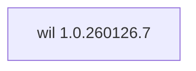

## Updated BuildEngine contract (10 November 2026)

**Declared configuration; no new test PASS.**

### Complete transitive dependencies

Direct: none

### Current configuration

- `-DCMAKE_TOOLCHAIN_FILE:FILEPATH={BuildFileDir}\cmake\toolchains\bcc64x-buildengine-cxx.cmake`
- `-DCMAKE_MAKE_PROGRAM:FILEPATH={Tool:ninja}`
- `-DCMAKE_INSTALL_PREFIX:PATH={InstallRoot}\packages\{LibraryId}\{LibraryVersion}`
- `-DCMAKE_INSTALL_INCLUDEDIR:STRING=include`
- `-DCMAKE_INSTALL_DATADIR:STRING=share`
- `-DWIL_BUILD_PACKAGING:BOOL=OFF`
- `-DWIL_BUILD_TESTS:BOOL=OFF`
- `-DCMAKE_BUILD_TYPE:STRING=Release`
- `-DCMAKE_BUILD_TYPE:STRING=Debug`
- `-Dwil_DIR:PATH={InstallRoot}\packages\{LibraryId}\{LibraryVersion}\share\cmake\WIL`

---

## Historical integration notes

# Windows Implementation Library (WIL) 1.0.260126.7

[TOC|Content]

## Current BuildEngine contract (10 November 2026)

**Contract data, not verified build execution.** Earlier test results apply only to exact versions and builds; new runs remain **[not verified]**.

Microsoft MIT-licensed header-only Windows COM and RAII library. BCC64X compatibility requires a native consumer smoke before use by OpenCV.

**Coordinate:** `wil@1.0.260126.7` · **Category:** `foundation` · **License indicator:** `yellow`

### Declared dependencies (full transitive closure)

Edges come from exactly pinned XML dependencies. Dashed edges denote extensions, solid edges package dependencies. Bundled upstream components are not additional BuildEngine coordinates.

**Direct dependencies:** None declared.

### Configuration and integration notes

**CMake arguments:**

- `-DCMAKE_TOOLCHAIN_FILE:FILEPATH={BuildFileDir}\cmake\toolchains\bcc64x-buildengine-cxx.cmake`
- `-DCMAKE_MAKE_PROGRAM:FILEPATH={Tool:ninja}`
- `-DCMAKE_INSTALL_PREFIX:PATH={InstallRoot}\packages\{LibraryId}\{LibraryVersion}`
- `-DCMAKE_INSTALL_INCLUDEDIR:STRING=include`
- `-DCMAKE_INSTALL_DATADIR:STRING=share`
- `-DWIL_BUILD_PACKAGING:BOOL=OFF`
- `-DWIL_BUILD_TESTS:BOOL=OFF`
- `-DCMAKE_BUILD_TYPE:STRING=Release`
- `-DCMAKE_BUILD_TYPE:STRING=Debug`

**Build environment:**

- `CB_BCC64X={Tool:bcc64x}`
- `CB_BDS={BDS}`

**Versionsgebundene Patches:**

- `{Workspace}\.buildengine\patches\bcc64x-sdk-atomics.patch`
- `{BuildFileDir}\patches\wil\1.0.260126.7\bcc64x-sdk-atomics.patch`

**Source-Downloads:**

- `https://github.com/microsoft/wil/archive/cbf677fb0a942557d08fd129f4c106a76247b2ec.zip`

**Deklarierte Smoke-Tests:**

- `consumer` / `Release` / `package` / `smokes\wil\consumer`

**Explizit geforderte Installationsartefakte:**

- `{InstallRoot}\packages\{LibraryId}\{LibraryVersion}\include\wil\com.h`
- `{InstallRoot}\packages\{LibraryId}\{LibraryVersion}\share\cmake\WIL\wilConfig.cmake`
- `{InstallRoot}\packages\{LibraryId}\{LibraryVersion}\LICENSE`
- `{InstallRoot}\packages\{LibraryId}\{LibraryVersion}\ThirdPartyNotices.txt`

**Verbindliche Sources:** `admin/build-libraries.xml` for configuration and pins; FSM/build logs for actual execution. [Library catalog](/manual/libraries.md).
