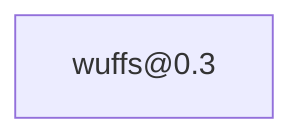

# wuffs 0.3: BuildEngine integration

[TOC|Content]

## Purpose and current integration

Stable 0.3 single-file C image and data decoding library; source/header distribution, no DLL

**BuildEngine package:** `wuffs@0.3`  
**Upstream source reference:** `e3f919ccfe3ef542cfc983a82146070258fb57f8`  
**Status:** Successful completion of the 109/109 BuildEngine integration run was confirmed on 15 November 2026. This is not a claim that Skia's separately bundled upstream copies have been replaced by the corresponding external packages.

## Direct and transitive dependencies

No direct BuildEngine package dependency is declared.

The graph follows the version-specific BuildEngine XML dependency declarations. Shared dependencies are shown once. It does not infer binary linkage from the presence of a package in the overall closure.

## Build configuration

**Toolchain:** Windows x64, RAD Studio C++Builder BCC64X, CMake/Ninja where configured. BuildEngine injects the paths and versions from its dependency and tool registries; no machine-specific absolute path is part of this guide.

This package is installed using the source/install workflow defined in the XML contract; no CMake `-D` switches are declared for this version.

## Integration patches and special considerations

No version-specific source patch is declared in the source workflow.

Wuffs is installed as a stable source/header distribution without a runtime DLL.

## Verification and maintenance

The overall BuildEngine run was reported successful for 109 versioned library integrations. Check each package's installed artifacts and its package-specific logs for per-configuration and consumer-test evidence. The authoritative configuration is `admin/build-libraries.xml`; do not duplicate dependency paths or names as fixed values outside its variables.

[Library overview](/manual/libraries.md)
