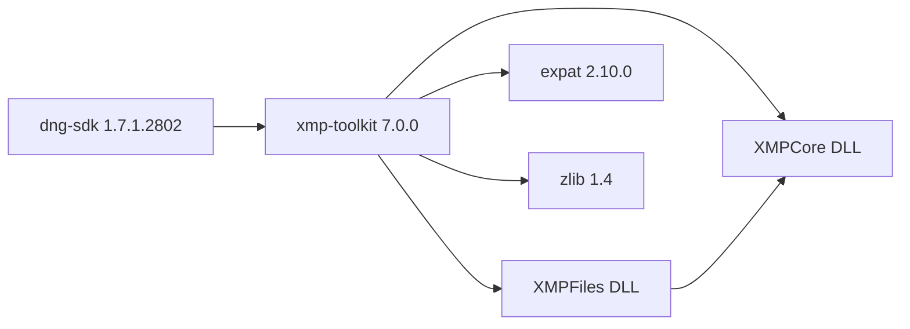

# Adobe XMP Toolkit 7.0.0 — managed XMPCore and XMPFiles

[TOC|Content]

## Scope and provenance

The DNG SDK 1.7.1 Build 2802 mirror at `hfiguiere/dng_sdk`, pinned to commit `3a31897afe53aad5f15854eba0f04bab77cc4f82`, contains Adobe XMP Toolkit sources under `xmp/toolkit`. Its public `XMP_Version.h` declares XMPCore and XMPFiles API version 7.0. The distribution's `XMP_ReadMe.txt` explicitly identifies Adobe XMP as a DNG SDK prerequisite.

The logical BuildEngine coordinate is `xmp-toolkit@7.0.0`. The shared source archive is intentionally pinned to the same revision as `dng-sdk@1.7.1.2802`. This is the version carried by that Adobe DNG release, not an independently asserted latest Adobe XMP release.

The original Adobe SDK license is preserved as `licenses/xmp-toolkit/LICENSE.txt`, with yellow license signal. Redistribution and license rights require review; this record is not an OSI open-source declaration.

## Architecture

BuildEngine's Library-FSM owns source acquisition, Build/Debug, installation, publication, and consumer smoke. Version and dependency relationships are exclusively declared in `admin/build-libraries.xml`.

The CMake integration adapter at `admin/cmake/adapters/xmp-toolkit/CMakeLists.txt` produces separate `XMPCore.dll` and `XMPFiles.dll` with matching import libraries. XMPFiles links XMPCore. The package uses the configured BCC64X Clang driver and mandatory dynamic Embarcadero runtime; it never selects MinGW GCC or MSVC.

The public XMP SDK includes and the two libraries are installed under the standard versioned `include/xmp`, `lib/win64/{Configuration}`, and `bin/win64/{Configuration}` package paths. External Expat 2.10.0 and zlib 1.4 are BuildEngine dependencies, not silently compiled bundled sources.

## Verification

The installed-package consumer in `admin/smokes/xmp-toolkit/consumer` initializes both XMPCore and XMPFiles, sets a Dublin Core text property and reads it back through the public XMP API. It must pass with the published import libraries and runtime DLL search path, not by linking against private source artifacts.

**[not verified]** Native Release and Debug configure/build/install and installed consumer smoke have not yet executed on the operator's Windows build host. Native toolchain diagnostics and actual runtime PE dependency inspection are still acceptance gates.
