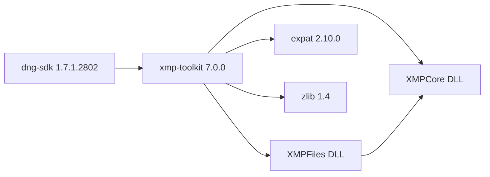

# Adobe XMP Toolkit 7.0.0 — managed XMPCore and XMPFiles

## Concurrent source archive cache isolation (16 November 2026)

DNG SDK and XMP Toolkit intentionally fetch the same pinned upstream commit, but their independent FSM source producers previously declared the same local download archive `dng-sdk-1.7.1.2802.tar.gz`. During concurrent downloads, both attempted to write and rename the same `.part` file, causing a Windows sharing violation. The XMP Toolkit archive name is now `xmp-toolkit-7.0.0-dng-sdk-1.7.1.2802.tar.gz`, while its upstream URL, extracted root, commit, and all features remain unchanged. This isolates concurrent cache keys without serializing the build or introducing another source release. The XMP logical timestamp is `2026-11-16T14:04:00Z`.

**[not verified]** The next concurrent native source download and Debug/Release builds must confirm successful operation.

## BCC64X Clang SAL annotation compatibility (16 November 2026)

The next native Debug/Release compilation failed at `source/SafeStringAPIs.h:122` on `_Check_return_wat_`. This is an Adobe annotation configuration issue: `SafeStringAPIs.h` already includes `SuppressSAL.h`, but that compatibility header only defines empty SAL annotations for non-Windows targets. BCC64X identifies as Windows while using Clang, and its headers do not provide that legacy MSVC annotation.

The version-pinned `clang-sal-annotations.patch` extends Adobe's existing portability branch to Clang on Windows. This restores the complete set of Adobe-provided SAL annotation macros rather than adding one-off definitions for `_Check_return_wat_` or changing the function implementations. XMP functionality, the native Windows platform path, and the BCC64X toolchain remain unchanged. The standard source check/apply/reverse-check workflow is retained; the XMP logical source timestamp is now `2026-11-16T14:03:00Z`.

**[not verified]** A new native BCC64X Debug/Release build and XMP consumer have not yet been observed.

## BCC64X Clang TR1 compatibility correction (16 November 2026)

The native XMPCore build reached `XMPCommonFwdDeclarations.h:40` and failed because `std::tr1` is absent from the compiler's standard library. Adobe's `XMPCommonDefines.h` selects the pre-Visual Studio 2010 TR1 path whenever `_MSC_VER <= 1600`; BCC64X uses modern Clang, whose compiler identity must take precedence over that historical MSVC version test. The pinned `clang-standard-shared-ptr.patch` excludes `__clang__` from the legacy branch, restoring `std::shared_ptr`, `std::enable_shared_from_this`, `std::mem_fn`, and the existing standard atomic implementation, without disabling XMP functionality.

The source FSM checks, applies, and reverse-checks the patch, with logical XMP timestamp `2026-11-16T14:02:00Z`. **[not verified]** Native Debug/Release build and installed consumer smoke remain outstanding.

[TOC|Content]

## Scope and provenance

The DNG SDK 1.7.1 Build 2802 mirror at `hfiguiere/dng_sdk`, pinned to commit `3a31897afe53aad5f15854eba0f04bab77cc4f82`, contains Adobe XMP Toolkit sources under `xmp/toolkit`. Its public `XMP_Version.h` declares XMPCore and XMPFiles API version 7.0. The distribution's `XMP_ReadMe.txt` explicitly identifies Adobe XMP as a DNG SDK prerequisite.

The logical BuildEngine coordinate is `xmp-toolkit@7.0.0`. The shared source archive is intentionally pinned to the same revision as `dng-sdk@1.7.1.2802`. This is the version carried by that Adobe DNG release, not an independently asserted latest Adobe XMP release.

The original Adobe SDK license is preserved as `licenses/xmp-toolkit/LICENSE.txt`, with yellow license signal. Redistribution and license rights require review; this record is not an OSI open-source declaration.

## Architecture

BuildEngine's Library-FSM owns source acquisition, Build/Debug, installation, publication, and consumer smoke. Version and dependency relationships are exclusively declared in `admin/build-libraries.xml`.

The CMake integration adapter at `admin/cmake/adapters/xmp-toolkit/CMakeLists.txt` produces separate `XMPCore.dll` and `XMPFiles.dll` with matching import libraries. XMPFiles links XMPCore. The package uses the configured BCC64X Clang driver and mandatory dynamic Embarcadero runtime; it never selects MinGW GCC or MSVC.

The public XMP SDK includes and the two libraries are installed under the standard versioned `include/xmp`, `lib/win64/{Configuration}`, and `bin/win64/{Configuration}` package paths. External Expat 2.10.0 and zlib 1.4 are BuildEngine dependencies, not silently compiled bundled sources.

## Verification

The installed-package consumer in `admin/smokes/xmp-toolkit/consumer` initializes both XMPCore and XMPFiles, sets a Dublin Core text property and reads it back through the public XMP API. It must pass with the published import libraries and runtime DLL search path, not by linking against private source artifacts.

**[not verified]** Native Release and Debug configure/build/install and installed consumer smoke have not yet executed on the operator's Windows build host. Native toolchain diagnostics and actual runtime PE dependency inspection are still acceptance gates.
