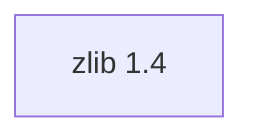

## Updated BuildEngine contract (10 November 2026)

**Current declaration; no new PASS claim.** Historical findings are preserved below.

### Complete transitive dependency graph

**Direkte Versionen:** keine

### Configuration and integration notes

- `-DCMAKE_TOOLCHAIN_FILE:FILEPATH={BuildFileDir}\cmake\toolchains\bcc64x-buildengine-cxx.cmake`
- `-DCMAKE_PROJECT_INCLUDE:FILEPATH=`
- `-DCMAKE_MAKE_PROGRAM:FILEPATH={Tool:ninja}`
- `-DCMAKE_INSTALL_PREFIX:PATH={InstallRoot}\packages\{LibraryId}\{LibraryVersion}`
- `-DCMAKE_INSTALL_INCLUDEDIR:STRING=include`
- `-DCMAKE_INSTALL_DOCDIR:STRING=share/doc`
- `-DZLIB_BUILD_SHARED:BOOL=ON`
- `-DZLIB_BUILD_STATIC:BOOL=OFF`
- `-DZLIB_BUILD_TESTING:BOOL={TestsEnabled}`
- `-DZLIB_INSTALL:BOOL=ON`
- `-DZLIB_PREFIX:BOOL=OFF`
- `-DCMAKE_BUILD_TYPE:STRING=Release`
- `-DCMAKE_C_FLAGS_RELEASE:STRING=-O2 -DNDEBUG`
- `-DCMAKE_INSTALL_LIBDIR:STRING=lib/win64/Release`
- `-DCMAKE_INSTALL_BINDIR:STRING=bin/win64/Release`
- `-DCMAKE_BUILD_TYPE:STRING=Debug`
- `-DCMAKE_C_FLAGS_DEBUG:STRING=-O0`
- `-DCMAKE_DEBUG_POSTFIX:STRING=d`
- `-DCMAKE_INSTALL_LIBDIR:STRING=lib/win64/Debug`
- `-DCMAKE_INSTALL_BINDIR:STRING=bin/win64/Debug`
- Patch: `{Workspace}\.buildengine\patches\{LibraryVersion}\bcc64x-rc-version-only.patch`
- Patch: `{Workspace}\.buildengine\patches\{LibraryVersion}\bcc64x-nested-ctest-rc-flags.patch`

---

## Bisherige Migrations- und Integrationsnotizen

# zlib 1.4: BCC64X migration

[TOC|Content]

**Version:** `zlib@1.4` · **Target:** native BCC64X Windows x64 · **Product:** shared DLL only

Retain zlib 1.3.2 for reproducibility and supersede it with zlib 1.4.
Official upstream zip: `zlib14.zip`; SHA-256:
`38bc7ed1c8ac3c870a159623deacf74a46c393ae1ad23f1dca1ed8e272deb058`.

- The upstream `win32/zlib-cmake.rc` includes `../zlib.h`; that triggers `zconf.h` including C `stddef.h`. The actual BCC64X BuildEngine log reports `RC1015: cannot open include file 'stddef.h'` at `zconf.h(268)`. The SDK resource compiler `rc.exe` and the SDK include directories are already correctly selected. The version-scoped, checked `bcc64x-rc-version-only.patch` replaces that one C header include with `ZLIB_VERSION`, `ZLIB_VER_MAJOR`, `ZLIB_VER_MINOR`, and `ZLIB_VER_REVISION` as defined in upstream zlib 1.4. No global BuildEngine changes or resource-compiler substitutions are necessary.
- Use `ZLIB_BUILD_SHARED=ON`, `ZLIB_BUILD_STATIC=OFF`, `ZLIB_PREFIX=OFF`.
- Keep the exact BCC64X product contract: Release `libz.dll/libz.lib` and Debug `libzd.dll/libzd.lib`. Verify real outputs in installed-artifact gates.
- The CTest runtime DLL `PATH` remains configured by the versioned BuildEngine test action. Two nested Upstream CMake tests (`zlib_add_subdirectory_configure` and `zlib_add_subdirectory_exclude_configure`) invoke CMake again, but do not forward `CMAKE_RC_FLAGS`. In the supplied Release CTest log, these configure successfully and then fail at `win32/zlib-cmake.rc` with `RC1015: cannot open include file 'winver.h'` because the nested `rc.exe` commands lack the SDK `/I` arguments. The new checked `bcc64x-nested-ctest-rc-flags.patch` forwards `"-DCMAKE_RC_FLAGS:STRING=${CMAKE_RC_FLAGS}"` in only these two test configurations, preserving the existing compiler, toolchain and resource-compiler selection.
- Preserve the shared CMake export, pkg-config, headers, LICENSE, upstream tests, and installed-package consumer.

**Verified from the supplied 2026-11-07 Release log:** zlib's main build and the `zlib_install`, `zlib_example`, `zlib_example64`, and `find_package` CTest checks passed. CTest reported 10 of 14 tests passed; the remaining four results were two nested builds failing due to missing SDK RC include flags and their unrun dependents. **[not verified]** All 14 CTest cases after this patch, the Debug configuration, and the installed consumer smoke remain pending. This XML addition does not update existing downstream dependency version pins.

Source: https://github.com/madler/zlib/releases/tag/v1.4

## Source-state invalidation after the nested CTest fix

The nested RC-flags source patch was committed after the zlib 1.4 library timestamp was last updated. As a result, a normal `--make` run could reuse a completed Source scope and omit the new patch, even though it was present in the administration repository. The empty `Select-String` results from the actual extracted `test/CMakeLists.txt` demonstrate that the additional change was not applied to that working copy.

The zlib 1.4 library coordinate's contract timestamp was advanced from `2026-11-07T17:11:00Z` to `2026-11-07T17:24:00Z`. Under the documented logical FSM current-state contract, this invalidates the stale Source evidence for this library without touching the BuildEngine implementation. For verification, run `BuildEngine --make --lib=zlib --libversion=1.4 --config=Release,Debug` after synchronizing Admin; verify both `CMAKE_RC_FLAGS:STRING` occurrences in the extracted upstream test CMakeLists.txt, then run the full test pipeline.

## Version 1.4 dependency-closure upgrade

The user-provided 2026-11-07 BuildEngine FSM log verifies zlib 1.4 source, Debug/Release build and tests, Debug/Release install, metadata, publish, Doxygen, Release consumer smoke, and Ready as PASS.

The following 20 declared direct zlib consumers now pin `<dependency library="zlib" version="1.4"/>`: `libzip@1.11.4`, `openssl@3.5.9`, `curl@8.23.0`, `boost@1.92.0`, `ace@8.0.6`, `libpq@18.6`, `leptonica@1.87.0`, `opencv@5.0.0`, `libpng@1.6.59`, `freetype@2.14.3`, `libtiff@4.7.2`, `skia@144`, `skia@153`, `teckit@2.5.13`, `libxml2@2.15.3`, `qpdf@12.4.1`, `podofo@1.1.1`, `poppler@26.09.0`, `pdfium@2025.11.19`, `mariadb-connector-c@3.4.11`. The new `libarchive@3.8.11` also pins zlib 1.4 and LZ4 1.10.0.

Two extension consumers (`tao@4.0.6` via ACE and `libpqxx@8.0.2` via libpq) now refer to `{DependencyRoot:zlib}`, not hard-coded package versions. Adjacent existing Xerces-C/libpq hardcoded package roots are likewise resolved through dependency variables. The `skia@144` package is included because `pdfium@2025.11.19` still explicitly consumes it.

Historic library coordinates retained with old zlib 1.3.2 pins: `libarchive@3.8.9`, `libarchive@3.8.10`, `openssl@3.5.8`, `curl@8.21.0`, `libpng@1.6.58`. The 3.8.10 coordinate is now superseded by libarchive 3.8.11; it remains buildable using its original dependency versions.

All changed active coordinates received `timestamp="2026-11-07T17:24:00Z"` to invalidate their stale FSM evidence. **[not verified]** Their rebuilt BCC64X installations and consumer tests, including libarchive 3.8.11, still require execution; zlib 1.4 Ready alone does not establish downstream compatibility.
