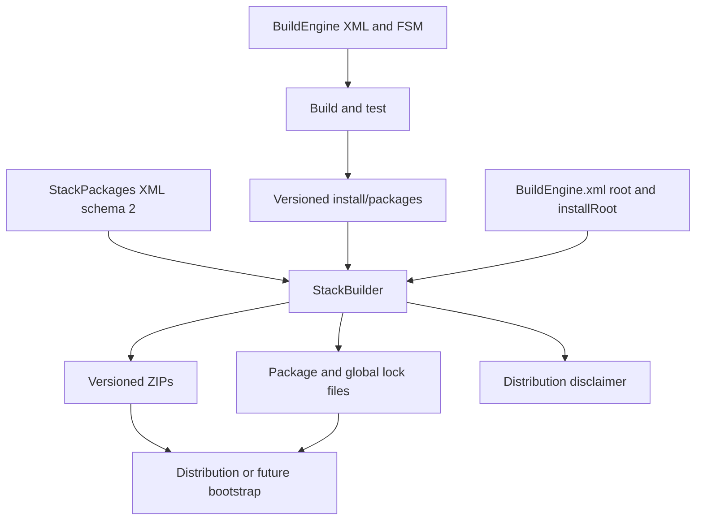
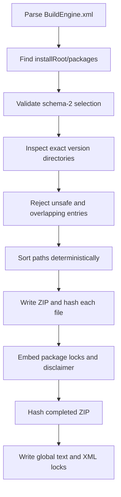

# StackBuilder: Packaging and Distributing the BuildEngine Third-Party Stack

[TOC|Content]

## Purpose

StackBuilder is a separate C++23 console application from the [BuildEngine repository](https://github.com/adeccscholar/BuildEngine/tree/main/StackBuilder). It packages a deliberately selected set of **already installed** libraries for distribution and future bootstrap use. It is not another builder: compilation, testing, installation and the corresponding finite-state-machine (FSM) evidence remain BuildEngine responsibilities.

The separation matters because the distributable stack must be reproducible, auditable, and independent of the workstation on which the packages were originally compiled. A package archive contains the selected installed files unchanged, together with machine-readable identity and integrity information.



## Requirements and ownership

StackBuilder uses the installed libraries in `<installRoot>/packages`, not the original source or build workspace. It does not download upstream releases, choose the newest version, automatically resolve transitive dependencies, start the BuildEngine FSM, or re-run smoke tests.

The implementation uses **pugixml** for XML parsing and lock-file generation, **libarchive** for ZIP archives with deflate compression and **OpenSSL libcrypto EVP** for SHA-256 hashing. The application uses the native Windows/BC C64X toolchain and standard C++23 facilities.

The authoritative implementation is in [Main.cpp](https://github.com/adeccscholar/BuildEngine/blob/main/StackBuilder/Main.cpp) and [StackBuilder.cpp](https://github.com/adeccscholar/BuildEngine/blob/main/StackBuilder/StackBuilder.cpp). The original project README contains an older description of the `buildRoot/ThirdParty` and schema-1 format; those parts no longer describe the current implementation.

## Inputs and command line

```text
StackBuilder --packages=<selection.xml> --output=<directory> [BuildEngine.xml]
StackBuilder --help
```

Both `--packages` and `--output` are required. If `BuildEngine.xml` is omitted, StackBuilder looks for it beside the executable.

The program reads the `<buildEngine>` configuration, resolves `parameters/@root` relative to the location of `BuildEngine.xml` if necessary, then resolves `parameters/@installRoot` relative to that production root. The package base is:

```text
<resolved installRoot>/
   packages/
      zlib/
         1.3.2/
            include/
            lib/
            bin/
            ...
      boost/
         1.92.0/
            ...
```

The package/version selection file must be an XML document with root `stackPackages` and `schemaVersion="2"`. Each selected `package` requires a non-empty `name`, `version` and `release`. `toolchain` defaults to `bcc64x` if absent. All coordinate elements must be safe filename components.

### Example: select exactly two installed packages

```xml
<?xml version="1.0" encoding="utf-8"?>
<stackPackages schemaVersion="2" toolchain="bcc64x">
   <package name="zlib" version="1.3.2" release="2026.10.18-1"/>
   <package name="boost" version="1.92.0" release="2026.10.18-1">
      <additional path="bcc64x-native-clang"/>
   </package>
</stackPackages>
```

These release identifiers are **illustrative distribution identifiers**, not automatically detected upstream versions. The optional `additional` entry selects another existing subtree under `<installRoot>/packages/<name>/`, next to the package's version directory. This example assumes that the selected Boost additional subtree actually exists; otherwise StackBuilder rejects the selection.

Do not list a transitive dependency unless it is intentionally part of the distribution: StackBuilder does not discover and include other packages on the user's behalf. Duplicate package name/version pairs and duplicate or unsafe additional paths are rejected.

### Example: invoke from a Windows command prompt

```cmd
StackBuilder.exe --packages=D:\distribution\StackPackages.xml --output=D:\distribution\bcc64x D:\local\embarcadero\test_v3\BuildEngine.xml
```

A successful run reports how many packages were produced and prints the path of each ZIP. It does **not** imply that the packages have passed new tests during the packaging run.

## Packaging steps and reproducibility



For each selected package, StackBuilder scans the version directory and any declared additional directories. It accepts regular files and traverses directories. Symbolic links, unusual filesystem entries, overlapping file paths and collisions with reserved metadata names produce errors.

Files are sorted by their relative archive path. Archive entries use normalized timestamps (epoch zero), defined regular-file permissions and ZIP deflate compression. These measures reduce environment-dependent differences. Byte-for-byte reproducibility across all environments has not been independently established by this document.

SHA-256 is calculated while writing each source file to the archive; after the ZIP is closed, StackBuilder hashes the completed archive again.

## Output and lock-file contracts

```text
<output>/
   DISCLAIMER.md
   thirdparty.lock
   thirdparty.lock.xml
   packages/
      zlib-1.3.2-bcc64x.zip
      boost-1.92.0-bcc64x.zip
```

Each package ZIP contains the files selected from the installed library subtree and three generated entries:

```text
metadata/
   package.lock
   package.lock.xml
   BUILDENGINE-DISTRIBUTION-DISCLAIMER.md
```

The **package locks**, in text and XML schema-2 forms, record the package identity (`name`, `version`, `release`, `toolchain`) and the relative path, size and SHA-256 digest of every selected file.

The **global locks**, `thirdparty.lock` and `thirdparty.lock.xml`, record the toolchain, SHA-256 of the selection XML and, for each ZIP, its package identity, relative archive name, size and archive SHA-256. The text representation is deliberately simple enough to be parsed by a later minimal bootstrap program; the XML is intended for structured tooling.

**Important:** The ZIP filename contains `name-version-toolchain`, but not `release`. Two releases for the same package version and toolchain therefore produce the same ZIP filename within one output directory. Keep releases in separate output directories or establish an explicit replacement policy.

## Using a packaged stack

The intended Stage-0 bootstrap sequence is to obtain the global lock and archives from a trusted distribution, verify each ZIP's size and SHA-256 against the global lock, extract the archive safely, then verify its individual file hashes against `metadata/package.lock` before allowing the files into a project's include/library/runtime search paths.

This is the **planned consumer workflow**, not a claim that the current StackBuilder executable implements the bootstrap side. The current application **produces** packages and lock files; a separate bootstrap must consume and verify them.

For library consumers, ensure that the selected headers, Debug/Release binaries, imported dependencies and required runtime DLLs belong to the same compatible stack. In particular, **the managed Boost include directory must precede any other Boost installation** in the consumer's include-search order.

## Failure conditions and security

StackBuilder refuses missing configuration or selection files, an invalid schema, missing installed package directories, invalid package coordinates, unsupported symlinks or special entries, duplicate or overlapping source paths, missing additional directories and ZIP/digest write errors. It must not silently substitute another installed version.

All third-party licenses remain applicable. The distribution disclaimer explicitly disclaims a warranty and states that compilation or tests do not constitute certification or product-level approval. Packaging does not remove licensing, compatibility or security responsibilities.

## Related documentation

- [BuildEngine documentation contract](/manual/documentation.md): FSM-owned documentation production and rendering
- [Library migration records](/library-docs/): version-specific build strategies, patches, disabled features and consumer constraints
- [StackBuilder source and schema-2 selection example](https://github.com/adeccscholar/BuildEngine/tree/main/StackBuilder)
- [BuildEngine-Admin package documentation](https://github.com/adeccscholar/BuildEngine-Admin/tree/main/admin/docs/packages)

**Verification status:** The behavior documented above is derived from the current StackBuilder source and selection example. The Doc-Server route and this new Markdown document still require a runtime rendering test after synchronizing Admin.
