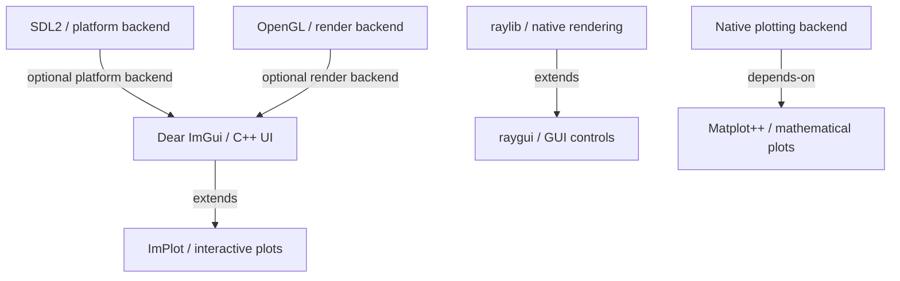
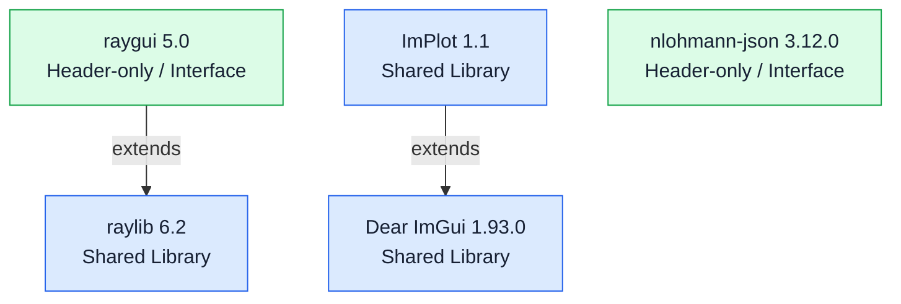

# BuildEngine News — 2026-11-18

## Native C/C++ UI, instruments and mathematical plots

Four new logical library integrations have been registered in the schema-17 catalog:

| Library | Version | Artifact contract | Relationship | License |
| --- | --- | --- | --- | --- |
| Dear ImGui | 1.93.0 | BCC64X shared DLL and import library | Standalone GUI core; platform/render backends selected by consumer | MIT |
| ImPlot | 1.1 | BCC64X shared DLL and import library | `extension type="package"` of imgui@1.93.0 | MIT |
| raygui | 5.0 | Header-only / Interface, no raygui DLL | `extension type="package"` of raylib@6.2 | zlib |
| Matplot++ | 1.2.2 | Planned native shared library | Standalone mathematical charting | MIT |

**Declared catalog after registration: 85 distinct library IDs / 120 versioned integrations**, including historical versions and superseded entries. Counts describe catalog records, not finished native builds.

The package model now differentiates two independent concepts: `depends-on` describes a technical prerequisite; `extends` denotes a functional package extension with its own identity, source, publication, licensing and consumer smoke. No separate ordinary dependency should duplicate an extension edge. `artifactType` independently classifies shared, static, interface and tool artifacts, so the server can explicitly display **Header-only / Interface** and must not expect a DLL for raygui or existing interface libraries such as nlohmann-json.

### Diagram 1 — build and feature relationships

The SDL2/OpenGL edges are **potential application backends**, not mandatory dependencies of the Dear ImGui core. Matplot++ backend requirements must be resolved before its native DLL is considered verified.

### Diagram 2 — artifact types and extension edges

The colored nodes indicate intended binary form, **not a completed build**. Interface libraries are verified through compiling and running BCC64X C++23 consumer code, not by checking for a shared library. For raygui, `RAYGUI_IMPLEMENTATION` must occur in one translation unit in the consumer.

### Packaging and BCC64X acceptance

- Use only the pinned upstream source and the BCC64X Clang toolchain. Do not substitute MSVC or MinGW output.
- Build separate Debug and Release DLL/import libraries for ImGui, ImPlot and Matplot++; verify both linking and runtime behavior.
- Install raygui as an interface/header-only package; include provenance, license and SBOM despite the absence of a binary.
- Every library has a dedicated `admin/smokes/<id>/consumer` integration scaffold. Runtime rendering and VCL embedding are distinct future demonstration gates.
- Avoid duplicating shared sources or inferring ownership from the base package. The ImPlot and raygui extensions own their respective artifacts and metadata.
- Check ImPlot 1.1 against the selected Dear ImGui 1.93.0 version: release publication alone does not prove upstream ABI/source compatibility.
- For Matplot++, verify the selected native plotting backend, transitive dependencies and corresponding licenses before declaring a usable DLL.

**Verification status: [not verified].** Sources, Debug/Release native builds, toolchain ABI, artifact installation, SBOM generation, smoke tests and graphical runtime tests remain pending. No package has been reported as built or installed by this entry.

[Dear ImGui integration](/package/imgui/1.93.0/migration) · [ImPlot integration](/package/implot/1.1/migration) · [raygui integration](/package/raygui/5.0/migration) · [Matplot++ integration](/package/matplotplusplus/1.2.2/migration)
