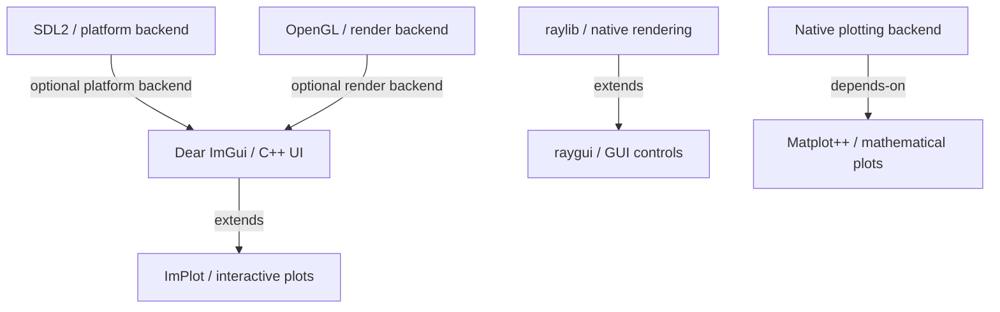
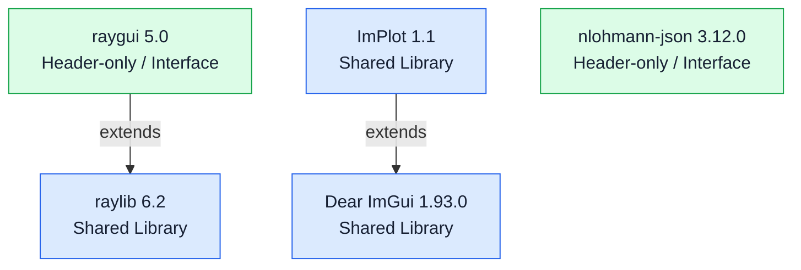

# BuildEngine News — 2026-11-18

## Final verification and visual demonstrations

The operator confirmed all 120 versioned FSM integrations completed on 2026-11-18 after the Dear ImGui install prefix correction, Matplot++ nodesoup linkage correction and consumer smoke protocol/runtime fixes. Catalog inventory: **85 distinct library IDs / 120 versioned records**. Completion is user-confirmed rather than independently reproduced here.

BuildEngine-Tests now includes independent C++23/BCC64X graphics projects for Dear ImGui Neon Constellation, ImPlot Signal Theater and Matplot++ Chaos Atlas. Each includes a standalone CMake build, offline CTest verification, description, build and presentation commands, project license, and declared CycloneDX 1.6 SBOM. [Graphics group](https://github.com/adeccscholar/BuildEngine-Tests/tree/main/graphics). **[not verified]** These newly added presentation applications require first native Windows compilation and visual examination.

The redundant legacy nested tests/pdf-image-extraction project and its mistakenly checked-in Ninja outputs were deleted; the newer root-level pdf-image-extraction implementation remains in place.

## Follow-up native FSM run: raygui ready, Matplot++ build passes

- The 120-machine FSM resumed with 115 finished, 4 active and 1 waiting. **raygui 5.0 reached READY:** the corrected consumer smoke passed and the interface packaging remained DLL-free.
- **Matplot++ 1.2.2:** the corrected Debug build passed, and both Release and Debug installs, common install, metadata, publication and Doxygen completed. The Release consumer still failed in CMake `find_library` during configuration. Inspection found the smoke expects `lib/win64/Release`, whereas the Matplot++ CMake contract did not set `CMAKE_INSTALL_LIBDIR`/`CMAKE_INSTALL_BINDIR`. Those per-configuration directories are now explicit; consumer linkage remains **not verified** until reconfigured, rebuilt/installed and tested against actual produced names.
- **Dear ImGui 1.93.0:** both install steps still report `cmake_install.cmake:41 (file)`. The supplied diagnostics do not contain the underlying CMake file-install error. The FSM resumed at install rather than showing a fresh configure, so the earlier install-prefix change may not have been applied to the existing CMake cache. The exact failure cannot be established without the full `01-cmake-install.log`. **No further ImGui root cause is claimed.**
- **ImPlot 1.1:** blocked by Dear ImGui installation, not an independent confirmed ImPlot build failure.
- Native snapshot: **117 finished, 2 failed, 1 blocked**. Catalog remains **85 unique library IDs / 120 versioned records**.

## First native execution feedback: package corrections

- **Dear ImGui 1.93.0 (Debug and Release install):** Initial native CMake installation failed at generated `cmake_install.cmake:41`. Configuration inspection showed that the ImGui adapter omitted `CMAKE_INSTALL_PREFIX`, causing CMake to use its default install destination rather than the versioned BuildEngine package root. The catalog now sets `-DCMAKE_INSTALL_PREFIX:PATH={InstallRoot}\\packages\\{LibraryId}\\{LibraryVersion}`. The same omission was corrected preemptively for ImPlot 1.1. The actual file-install exception details were not included in the supplied extract; this is a source-grounded correction, not a verified rerun.

- **Matplot++ 1.2.2 (Debug build):** Upstream `MATPLOTPP_BUILD_WITH_SANITIZERS` defaults to enabled in Debug configuration and injects `-fsanitize=leak`, which BCC64X rejects for `x86_64-w64-windows-gnu`. The catalog now explicitly sets `-DMATPLOTPP_BUILD_WITH_SANITIZERS:BOOL=OFF`. This preserves the compiler and native sources; the Release and Debug build results still need verification.

- **raygui 5.0 (Release smoke):** The compiled/running interface consumer returned `SMOKE|RESULT|PASS`, but the BuildEngine validator correctly rejected the run because no `SMOKE|CHECK|` record existed. The consumer now emits `SMOKE|CHECK|style|PASS/FAIL|...` before its final result. No DLL is introduced.

**Verification gate:** Reconfigure the affected CMake build trees before rerunning the installs/builds, since cached `CMAKE_INSTALL_PREFIX` and `MATPLOTPP_BUILD_WITH_SANITIZERS` values live in their existing CMake caches. The changes are committed, but the subsequent native rerun is **[not verified]**.

## Native C/C++ UI, instruments and mathematical plots

Four new logical library integrations have been registered in the schema-17 catalog:

| Library | Version | Artifact contract | Relationship | License |
| --- | --- | --- | --- | --- |
| Dear ImGui | 1.93.0 | BCC64X shared DLL and import library | Standalone GUI core; platform/render backends selected by consumer | MIT |
| ImPlot | 1.1 | BCC64X shared DLL and import library | `extension type="package"` of imgui@1.93.0 | MIT |
| raygui | 5.0 | Header-only / Interface, no raygui DLL | `extension type="package"` of raylib@6.2 | zlib |
| Matplot++ | 1.2.2 | Planned native shared library | Standalone mathematical charting | MIT |

**Declared catalog after registration: 85 distinct library IDs / 120 versioned integrations**, including historical versions and superseded entries. Counts describe catalog records, not finished native builds.

The package model now differentiates two independent concepts: `depends-on` describes a technical prerequisite; `extends` denotes a functional package extension with its own identity, source, publication, licensing and consumer smoke. No separate ordinary dependency should duplicate an extension edge. `artifactType` independently classifies shared, static, interface and tool artifacts, so the server can explicitly display **Header-only / Interface** and must not expect a DLL for raygui or existing interface libraries such as nlohmann-json.

### Diagram 1 — build and feature relationships

The SDL2/OpenGL edges are **potential application backends**, not mandatory dependencies of the Dear ImGui core. Matplot++ backend requirements must be resolved before its native DLL is considered verified.

### Diagram 2 — artifact types and extension edges

The colored nodes indicate intended binary form, **not a completed build**. Interface libraries are verified through compiling and running BCC64X C++23 consumer code, not by checking for a shared library. For raygui, `RAYGUI_IMPLEMENTATION` must occur in one translation unit in the consumer.

### Packaging and BCC64X acceptance

- Use only the pinned upstream source and the BCC64X Clang toolchain. Do not substitute MSVC or MinGW output.
- Build separate Debug and Release DLL/import libraries for ImGui, ImPlot and Matplot++; verify both linking and runtime behavior.
- Install raygui as an interface/header-only package; include provenance, license and SBOM despite the absence of a binary.
- Every library has a dedicated `admin/smokes/<id>/consumer` integration scaffold. Runtime rendering and VCL embedding are distinct future demonstration gates.
- Avoid duplicating shared sources or inferring ownership from the base package. The ImPlot and raygui extensions own their respective artifacts and metadata.
- Check ImPlot 1.1 against the selected Dear ImGui 1.93.0 version: release publication alone does not prove upstream ABI/source compatibility.
- For Matplot++, verify the selected native plotting backend, transitive dependencies and corresponding licenses before declaring a usable DLL.

**Verification status: [not verified].** Sources, Debug/Release native builds, toolchain ABI, artifact installation, SBOM generation, smoke tests and graphical runtime tests remain pending. No package has been reported as built or installed by this entry.

[Dear ImGui integration](/package/imgui/1.93.0/migration) · [ImPlot integration](/package/implot/1.1/migration) · [raygui integration](/package/raygui/5.0/migration) · [Matplot++ integration](/package/matplotplusplus/1.2.2/migration)
