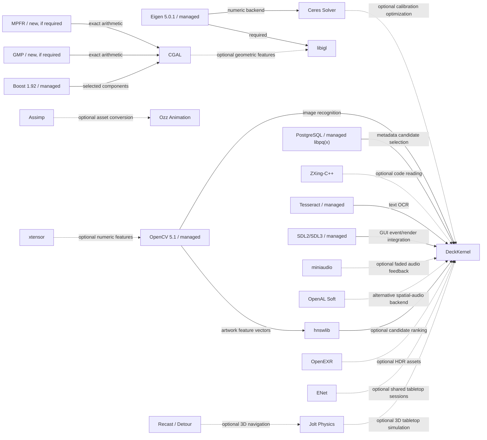

# BuildEngine News — 2026-11-19

## BuildEngine Server and full-library security review

**Inventory:** **85 distinct library IDs / 120 versioned integrations**, including retained historical revisions. The source of truth is `admin/build-libraries.xml` (schema 17), cross-checked against the published library catalog. No library registration, source stamp, binary, or dependency contract was changed by this review. The operator-reported complete 120/120 FSM result from 18 November remains the last reported native build status, not a new independent build or security certification.

### Server architecture and implementation status

The Server entry point remains thin, with HTTP routing and presentation owned by BuildEngine-Common. The live catalog compares complete XML bytes and invalidates its parsed view without relying exclusively on timestamps or file sizes. The separate assessment history and CVE-provider snapshot must not be conflated: the SQLite assessment database remains distinct from the independently refreshed OSV/NVD/EPSS/KEV evidence. PostgreSQL migration and storage contracts exist, but live persistence, restart rehydration and native acceptance must be verified before being described as operational.

The next Server acceptance checks are:
- Resolve `/library/<id>/active/` by the currently selected logical version before repository lookup. An `active` showcase link returning `{"error":"request could not be completed"}` is an unresolved route defect, not an acceptable absence of a version.
- Extend and document `/api/v1/libraries` and individual library/version responses with the latest *observed* run, variant-specific FSM result, observation timestamp, and separately sourced security status/findings. Preserve `not-scanned`, unavailable and stale evidence as explicit states; do not invent an aggregate safety result.
- Review HTML/UTF-8 encoding end to end. Replacement glyphs in headings such as `CVSS score history (0�10)` and `EPSS history (0�100%)` must be corrected at the source/response-encoding boundary and regression-tested. Validate CVSS/EPSS labels, legend, percentages and Unicode punctuation in both server HTML and generated descriptions.
- Reconcile package views and SBOMs with the active dependency graph and per-component ownership. Avoid double-counting transitive dependencies and do not reclassify Skia's intentionally embedded D3D12MemoryAllocator as a standalone DLL.
- Keep license and security signals independent. Provider severity, exploit probability, affected-version range, local build applicability, upstream fixes and installed artifact evidence must remain distinguishable.

**Verification:** These are requirements and review findings; this entry does not claim the pending active-route, REST response extension, encoding repairs or PostgreSQL runtime tests have been implemented.

### Review method and evidence limits

Every one of the 85 active library coordinates was inspected in the XML catalog. The broader inventory retains 35 superseded version records, which must also be scanned if downloadable or installed. Upstream security/release information was spot-checked for selected high-exposure libraries; **this is not a completed 120-version OSV/NVD CVE enumeration, installed-DLL verification, or final VEX assessment**. The absence of a found advisory does not prove a package safe. Dependency and feature applicability require the actual built SBOM and configuration.

The following active coordinates already contain notable recent upstream security fixes:
- `curl@8.23.0`: upstream reports zero *published vulnerabilities affecting 8.23.0* on its version table as of this review; its October 2026 release corrected multiple earlier vulnerabilities including CVE-2026-92392. See https://curl.se/docs/vuln-8.23.0.html and https://curl.se/docs/security.html.
- `openssl@3.5.9`: September 2026 upstream security patch release, including CVE-2026-84782 and several QUIC/DTLS/cryptographic fixes. Stay on the supported 3.5 branch unless a newer 3.5.x security release is verified. See https://openssl-library.org/news/openssl-3.5-notes/.
- `libpng@1.6.59`: includes the September fix for CVE-2026-46675 affecting compressed ancillary chunks. See https://www.libpng.org/pub/png/pngnews.html.
- `libjpeg-turbo@3.2.1`: October 2026 upstream release is verified; CVE-2026-75466 concerns a specialized high-bit-depth TurboJPEG PNG loader, but the specific fixed-version boundary was **not established** from the upstream release notes. Treat affectedness and remediation as **[not verified]** until the upstream fix commit and compiled code path are matched. See https://github.com/libjpeg-turbo/libjpeg-turbo/releases and https://access.redhat.com/security/cve/cve-2026-75466.
- `libxml2@2.15.4`: September security release includes bounds and overflow corrections. See https://gitlab.gnome.org/GNOME/libxml2/-/releases.
- `poppler@26.11.0`: November release fixes malformed-PDF crashes, among other correctness issues; these release notes do not by themselves prove a CVE-free state. See https://poppler.freedesktop.org/releases/.

### Priority queue for further verification

| Priority | Coordinates | Why they need additional attention | Recommended action |
| --- | --- | --- | --- |
| P1 | `pdfium@2025.11.19` | Date-pinned 2025 source in a frequently security-patched document parser; actual upstream commit and Chromium security backports are not established | Resolve exact commit and patch ancestry; compare with current PDFium security fixes, then stage a pinned update and PDF rendering/consumer regressions |
| P1 | `wuffs@0.3`, `libyuv@r1924`, `skia@153`, `piex@0.27` | Coarse, revision-based or roll-based coordinates require exact source provenance; version-only CVE matching may miss code changes | Record immutable upstream commit, component manifest and effective code in generated SBOMs; check security fixes against that revision |
| P1 | `openssl@3.5.9`, `curl@8.23.0`, `libpq@18.6`, `libpqxx@8.0.2` | Network/crypto/database boundary and transitive exposure, including actual loaded SSL libraries | Confirm runtime DLL closure, TLS features, supported-release status and CVE feeds |
| P1 | `libpng@1.6.59`, `libjpeg-turbo@3.2.1`, `libtiff@4.7.2`, `libwebp@1.6.0`, `libjxl@0.13.0`, `libavif@1.4.2`, `libaom@3.15.3`, `libgav1@0.20.0` | Untrusted image decoding and complex native parsers | Scan exact versions/features, verify bundled codecs are not shadowing managed libraries, fuzz malformed inputs and check fix versions before proposing an upgrade |
| P1 | `poppler@26.11.0`, `qpdf@12.4.2`, `podofo@1.1.2`, `openjpeg@2.5.4` | Untrusted PDF/document input | Correlate advisories with enabled features and run malformed-document tests |
| P2 | `expat@2.10.0`, `libxml2@2.15.4`, `xerces-c@3.3.0`, `pugixml@1.16`, `teckit@2.5.13` | XML/text conversion inputs | Validate current upstream patch levels, parser configuration and real input exposure |
| P2 | `sqlite@3.54.1`, `mariadb-connector-c@3.4.11` | SQL/database input and client protocol | Check current upstream security releases and shipped binaries |
| P2 | `freetype@2.15.0`, `harfbuzz@15.1.0`, `graphite2@1.3.15`, `icu@79.1`, `lcms2@2.20`, `tesseract@5.5.4`, `leptonica@1.87.0` | Font, shaping, text, OCR and image decoding | Scan upstream security and configure regressions for adversarial font/image input |
| P2 | `vtk@9.7.2`, `opencv@5.1.0`, `opencv-contrib` integration, `sdl2@2.32.10`, `sdl3@3.4.20`, `raylib@6.2` | Large graphics or media functionality and transitive native libraries | Compare dependency closure and pin upstream revisions before coordinated upgrades |
| P2 | `zlib@1.4`, `zstd@1.5.7`, `xz@5.8.4`, `brotli@1.2.1`, `bzip2@1.0.8`, `lz4@1.11.0`, `libdeflate@1.26`, `libarchive@3.8.11`, `libzip@1.12.1` | Archive decompression and possible resource exhaustion | Verify advisories, compression bomb controls and active transitive linkage |
| P3 | Remaining utility, math, rendering and testing libraries | Exposure is generally application- and feature-specific, not zero | Complete OSV/NVD enumeration for each coordinate, including historical versions and exact source commits |

These priorities express **review urgency**, not confirmed severity or proof of a vulnerable installed binary. No unverified target version is described as a security fix.

### Required acceptance gates before a library upgrade

1. Preserve the old pinned entry and introduce a new explicit version/commit with provenance, license and advisory references.
2. Determine the provider affected range and the specific fixed version/commit, and distinguish fixed upstream sources from local application applicability.
3. Rebuild with BCC64X/Clang, DLL-only contract where applicable, separate Debug and Release, proper installed import-library names and full native smoke consumers.
4. Recreate SBOMs and validate component identity, managed versus bundled origin, dependency closure and source commit.
5. Re-evaluate the Server's API/HTML assessment, CVE links, history plots and latest-run presentation against the new installed evidence.
6. Report counts separately: **85 unique libraries / 120 versioned integrations** at this snapshot; a new retained revision adds one versioned record without adding a logical library.

## New library candidates: mathematics, game development and DeckKernel

The following are **proposals only**, not added BuildEngine library records and not validated as BCC64X binaries. Exact release versions below were confirmed on upstream release pages where indicated; all integration/licensing and native Windows tests are open.

| Area | Proposed package | Proposed source version | Motivation and integration gate |
| --- | --- | --- | --- |
| Mathematics / computational geometry | CGAL | 6.2.1 | Exact predicates, meshes, triangulations and computational geometry; requires a controlled GMP/MPFR dependency/license evaluation and BCC64X Clang compatibility test; upstream's published tested compiler matrix does not establish BCC64X support. |
| Mathematics / mesh algorithms | libigl | 2.6.4 | Geometry processing and reusable algorithms; verify compatibility with managed Eigen 5.0.1; avoid blindly enabling every optional submodule. |
| Mathematics / optimization | Ceres Solver | upstream version **[not verified]** | Nonlinear least squares and camera calibration, with solver/BLAS backend and DLL ABI implications. |
| Mathematics / tensors | xtensor | upstream version **[not verified]** | N-dimensional expressions and numerics; header-only/interface packaging with C++23 smoke and allocator behavior checks. |
| Game / 3D physics | Jolt Physics | 5.6.0 | 3D rigid-body simulation, complementing existing Box2D 3.2.0; build the CPU core first and treat GPU backend dependencies as separate features. |
| Game / asset import | Assimp | 6.0.6 | Import of common 3D asset formats, with strict format and bundled-dependency review due to untrusted data parsing; release fixes must be checked against exact enabled importers. |
| Game / HDR graphics | OpenEXR | 3.5.4 | HDR asset processing, external Imath/OpenJPH dependencies and license provenance; add only when an actual HDR showcase/consumer requires it. |
| DeckKernel / nearest-neighbor candidates | hnswlib | upstream version **[not verified]** | Approximate nearest neighbor search for image feature vectors, subject to measured benefits over PostgreSQL candidate filtering and OpenCV feature comparison. |
| DeckKernel / barcode input | ZXing-C++ | upstream version **[not verified]** | Optional printed code recognition; not a replacement for card border detection, artwork matching or Tesseract OCR. |
| DeckKernel / optional inference | ONNX Runtime | upstream version **[not verified]** | Optional embedded vision model runtime; high-cost source-build feasibility under BCC64X, not a prerequisite for the existing deterministic pipeline. |

The highest-value **first native prototypes** are **libigl** (lightweight numerical geometry), **Jolt Physics** (distinct 3D game simulation), and **Ceres Solver** (camera/corner-calibration optimization). DeckKernel should first benchmark an approximate-nearest-neighbor index against the existing OpenCV and PostgreSQL path rather than adding a runtime with no evidence of better recognition speed or accuracy.

**Verified upstream release pages:** [CGAL](https://github.com/CGAL/cgal/releases), [libigl](https://github.com/libigl/libigl/releases), [Jolt Physics](https://github.com/jrouwe/JoltPhysics/releases), [Assimp](https://github.com/assimp/assimp/releases), [OpenEXR](https://github.com/AcademySoftwareFoundation/openexr/releases).

## Dated assessment XML and PostgreSQL ownership (19 November evening)

XML is the **only assessment exchange and distribution artifact**. The canonical document is [admin/security/assessments.xml](https://github.com/adeccscholar/BuildEngine-Admin/blob/main/admin/security/assessments.xml); the previous research-only XML has been retired. The PostgreSQL database owns canonical `cve`, `version_cve`, `cve_rating` and dated `cve_assessment` records. No SQLite archive participates in the current workflow. The reviews are real engineering judgments and are subject to operator review before production.

The current XML exchange contains twenty dated CVE/version assessments, including the verified BuildEngine `curl@8.21.0` configuration exclusion (`USE_NGHTTP2=OFF`) for CVE-2026-92392 and upstream fixed-version decisions for curl, OpenSSL, libpng and libjpeg-turbo. Older OpenSSL, libpng and libjpeg-turbo versions retain explicit unresolved applicability where build/runtime feature evidence is missing. Raw provider CVSS, EPSS and KEV and every historical version-to-CVE relationship remain intact, even after effective-risk neutralization.

BuildEngine-Server now contains a native PostgreSQL XML import function deployed through `internal/postgresql/Update_1.sql` (also included in the baseline SQL). When PostgreSQL is configured, startup imports `<ProductionRoot>/admin/security/assessments.xml`; identical dated decisions are idempotent and same-date conflicting decisions fail. BuildEngine-Common exposes the latest dated decision alongside provider facts; the CVE detail page highlights the current per-version effective risk, flags stale assessments after build-contract changes and retains full history. **Native BCC64X compilation, PostgreSQL execution and browser acceptance remain [not verified].**

The nine-library migration plan is maintained separately in [the integration plan](https://github.com/adeccscholar/BuildEngine-Admin/blob/main/admin/docs/NINE_LIBRARY_INTEGRATION_PLAN_2026-11-19.md). Security-version upgrades of existing packages remain scheduled for the weekend review and have not been implemented.

[Library inventory](/manual/libraries.md) · [Security](/security/) · [Server guide](/manual/server.md) · [News](/news/)

## Game, mathematics and DeckKernel library brainstorming (19 November)

This is a **technical shortlist, not a registration or build-completion announcement**. The existing catalog remains **85 distinct library IDs / 120 versioned integrations**. The candidates are being considered under the same source-first, BCC64X Clang / C++23, Ninja, Debug/Release, independently managed dependencies, license, SBOM and real consumer-test policy as the current stack.

### Recovered earlier game-programming discussion

The prior game-oriented shortlist included **SDL3**, **Box2D**, **OpenAL Soft 1.25.2**, **Assimp**, and **ENet 1.3.18**. The earlier ideas also included **Jolt Physics**, **Recast Navigation** and **Ozz Animation**. SDL3 3.4.20 and Box2D 3.2.0 are **already managed packages**, not proposed new registrations. OpenAL Soft remains the spatial-audio candidate from the shortlist.

**Audio fading distinction:** miniaudio is an additional, complementary candidate because it explicitly supports timed fades via `ma_sound_set_fade_in_milliseconds` and `ma_sound_set_fade_in_pcm_frames`. Do not attribute these miniaudio API functions to OpenAL Soft. Both libraries can be compared through a native SDL2/SDL3 audio showcase before deciding which engine to integrate. Documentation: [miniaudio manual](https://miniaud.io/docs/manual/), [OpenAL Soft](https://github.com/kcat/openal-soft).

### Full proposed library shortlist

The **DeckKernel fit** column describes a *possible* consumer use, not an already integrated or demonstrated feature. Release versions marked **verify** are deliberately left unpinned until exact upstream tag and source checksums are confirmed.

| Area | Candidate | Target or release to verify | Key relationship | DeckKernel reference-project opportunity |
| --- | --- | --- | --- | --- |
| Audio | **OpenAL Soft** | 1.25.2 (revalidate) | Standalone spatial audio backend; compare, not conflate, with miniaudio | Optional spatial audio for card placement/recognition feedback; probably unnecessary in the core recognition pipeline |
| Audio | **miniaudio** | Verify release | Standalone audio engine; explicit fades and attenuation; SDL renderer independent | Short success/reject tones, fade-in/fade-out, audio cues without interfering with image acquisition |
| Networking | **ENet** | 1.3.18 (revalidate) | UDP packet networking; independent of curl HTTPS and Boost.Asio | Optional multiplayer/live shared collection sessions; no reason to replace PostgreSQL or Scryfall HTTP |
| Navigation | **Recast Navigation / Detour** | 1.6.0 (verify) | Navigation mesh and path finding; complements Jolt and CGAL, does not require either by default | Low relevance for recognition; useful only for an optional 3D tabletop visualization |
| Animation | **Ozz Animation** | Verify release | Runtime skeletal animation; possible Assimp asset-import pipeline, but not a hard dependency | Optional animated 3D presentation of cards; no requirement for the camera analysis |
| Physics | **Jolt Physics** | 5.6.0 | 3D rigid-body physics, distinct from existing Box2D 2D engine | Optional 3D card-table showcase; no expected gain in OCR/recognition |
| 3D import | **Assimp** | 6.0.6 | Asset ingestion to an application mesh format; optional source for Ozz animation conversion | Optional 3D scene/card-stand models; security-gate importer formats and malformed assets |
| HDR graphics | **OpenEXR** | 3.5.4 | External Imath and optional OpenJPH, plus managed zlib/zstd/libdeflate where supported | High-dynamic-range image captures or calibration assets; lower priority than standard camera formats |
| Computational geometry | **CGAL** | 6.2.1 | Managed Boost, plus GMP/MPFR where exact arithmetic required; potential algorithmic alternative to libigl | Robust card quadrilaterals, perspective geometry, intersections; benchmark against existing OpenCV first |
| Mesh processing | **libigl** | 2.6.4 | **Hard dependency: Eigen**, already managed as Eigen 5.0.1; optional CGAL/Embree/others remain excluded initially | Geometry of detected card planes, 3D meshes, calibration experiments |
| Optimization | **Ceres Solver** | Verify release | **Eigen** for core numeric work; optional sparse solver backends and separate libs | High relevance for homography/corner refinement and camera calibration; test speed/accuracy vs OpenCV |
| Tensors | **xtensor** | Verify release | xtl and optional xsimd dependencies must be pinned; compare with Eigen, not replace it blindly | Preprocessing and vectorized image features; validate against existing OpenCV and Highway |
| Similarity search | **hnswlib** | 0.9.0 (revalidate) | Produces a vector index from descriptors extracted by **OpenCV**; database remains **PostgreSQL** | **High-priority** large-scale artwork matching benchmark: recall, false positives, RAM, latency |
| Code recognition | **ZXing-C++** | 3.1.1 (revalidate) | Separate optional ROI reader; does not replace **Tesseract + Leptonica** OCR | Detect printed machine-readable codes if card or product workflows have them |
| Inference | **ONNX Runtime** | Verify release; high-cost feasibility | Optional model inference on image features, consumes OpenCV-prepared tensors | Later experimental image embeddings; BCC64X DLL and toolchain complexity make this nonblocking |

**Related managed components**: `eigen@5.0.1`, `opencv@5.1.0`, `highway@1.4.0`, `boost@1.92.0`, `curl@8.23.0`, `libpq@18.6`, `libpqxx@8.0.2`, `sdl2@2.32.10`, `sdl3@3.4.20`, `box2d@3.2.0`, `raylib@6.2`, `imgui@1.93.0` and `implot@1.1`. A relationship indicated as optional below must not silently be written into `build-libraries.xml` as a mandatory dependency.

### Relationship map

Solid connections represent a proposed concrete producer/consumer relationship or pre-existing reference dependency. Dotted connections represent *optional application-level uses or comparisons*, never asserted upstream hard dependencies. Ceres/Eigen and the exact CGAL/Boost/GMP/MPFR combinations must be checked against the chosen source revision.

### Engineering brainstorming and prototype tests

**DeckKernel as the reference project.** Start with four measurable gates: (1) HNSW index versus PostgreSQL-plus-OpenCV artwork candidate matching on a fixed labeled card corpus; (2) Ceres geometric refinement on actual dark-bordered and split-card camera images, compared against the current OpenCV-only path; (3) miniaudio and OpenAL Soft audio cues with immediate cancel, fade and rapid repeated recognition events; (4) ZXing code scanning only where a verified input example justifies it. Record CPU time, memory use, precision/recall, duplicate selection rate and camera frame impact. New libraries are optional until a consumer demonstrates value.

**Game demonstrations.** Combine SDL3 (existing), Jolt Physics and ImGui (existing) in a native 3D rigid-body sample; use Recast/Detour for navigation only if scene geometry makes it meaningful. Assimp imports selected OBJ/glTF assets; Ozz Animation is a possible downstream runtime and requires a documented interchange/conversion bridge, not a fabricated direct build dependency. OpenEXR provides separate HDR samples. ENet should be tested with a standalone predictable packet-loss/retransmit sample, not silently placed on the server's HTTP path.

**Numerical demonstrations.** Use libigl with managed Eigen for mesh normals and distance queries, Ceres for known-solution nonlinear least squares and camera reprojection, CGAL for exact geometric degeneracies, and xtensor for multidimensional numerical arrays. Select components by algorithmic benefit and clean dependency closure, not by simply maximizing the number of libraries.

**Build acceptance**: native BCC64X Clang 20.1.7, source-pinned C++23, Ninja, real Debug/Release packages where binary-producing, separate header-only/interface consumer gates otherwise, licensing and source-provenance checks, installed import DLL names, dependency/extension relationships, SBOM and English Doxygen/migration documentation. No unverified upstream release or precompiled MSVC/MinGW artifact is accepted as a successful BuildEngine integration.

### SQL delivery convention and assessment timestamps

**Effective immediately, every database change must ship two explicit SQL files:**

1. **`admin/BuildEngine.sql`** — the complete, canonical greenfield PostgreSQL creation script, including all currently approved tables, views, roles, assessment import functions and safeguards.
2. **`admin/Update_1.sql`** — an additive update for an already provisioned database. Future deltas increment to `Update_2.sql`, `Update_3.sql` and so forth without silently replacing previous update files.

The pair is also mirrored under `BuildEngine-Server/internal/postgresql/`. The older lowercase `admin/buildengine.sql` remains a compatibility source until configuration references are explicitly migrated; it is not a third independently evolved schema design.

Assessment XML is the only assessment exchange medium. The identity `(library, version, CVE, changedAt)` is dated to the second with timezone; identical reimports are ignored, changed contents for the same date are rejected, and an intentionally changed judgment receives a later timestamp. `contractTimestamp` binds each review to a precise BuildEngine version configuration. Earlier judgments remain importable after a contract change and are shown as *stale* rather than continuing to neutralize a new build. PostgreSQL retains original CVE/provider history; the Server displays both provider severity and current effective risk. Database scripts and C++ importer changes require native PostgreSQL/Windows integration testing before runtime acceptance.

**Documentation:** [Nine-library engineering plan](https://github.com/adeccscholar/BuildEngine-Admin/blob/main/admin/docs/NINE_LIBRARY_INTEGRATION_PLAN_2026-11-19.md) · [Dated assessments XML](https://github.com/adeccscholar/BuildEngine-Admin/blob/main/admin/security/assessments.xml) · [Greenfield SQL](https://github.com/adeccscholar/BuildEngine-Admin/blob/main/admin/BuildEngine.sql) · [Update SQL](https://github.com/adeccscholar/BuildEngine-Admin/blob/main/admin/Update_1.sql)

