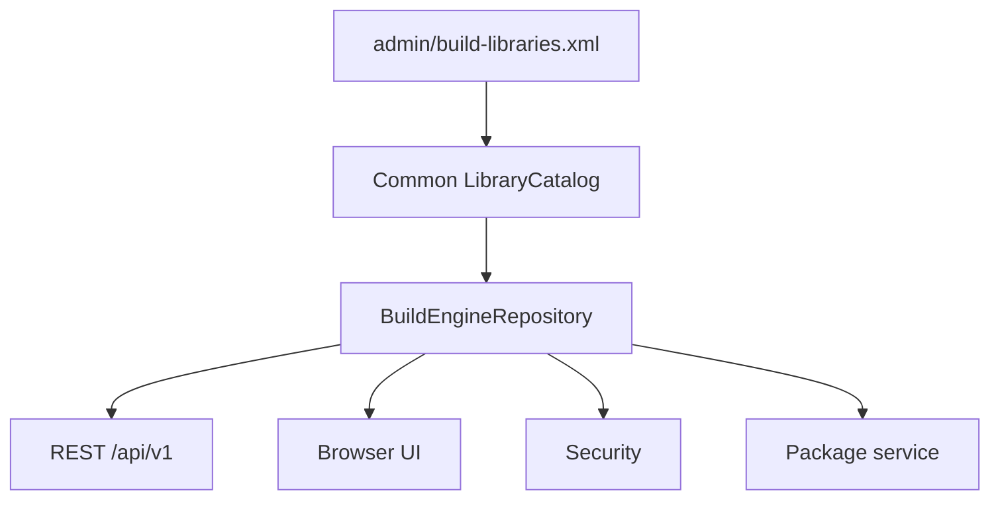
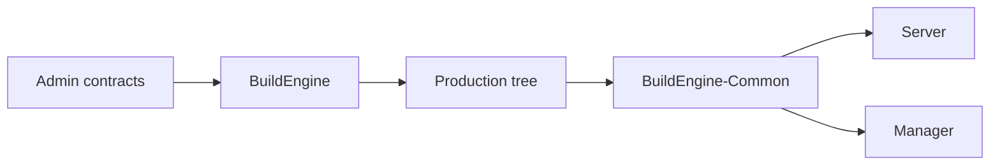
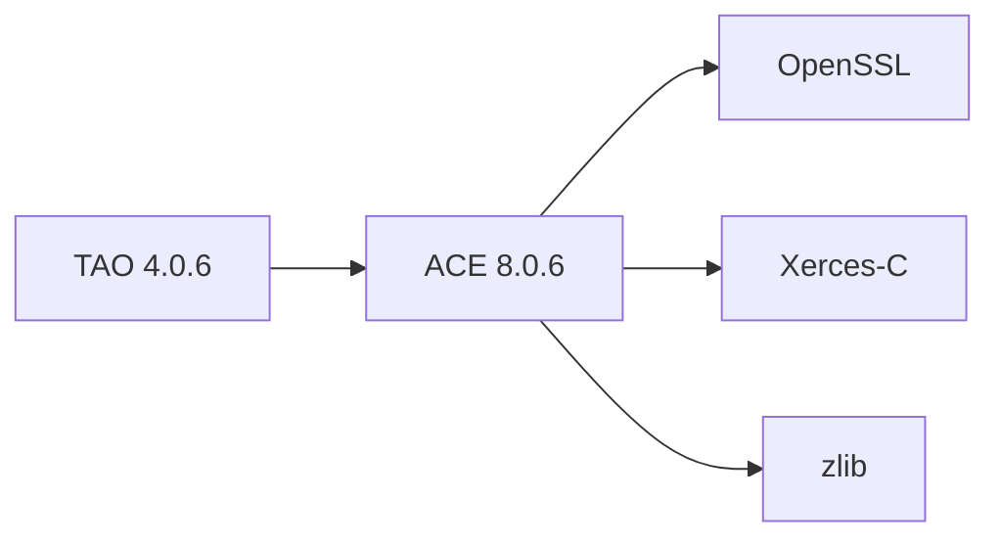
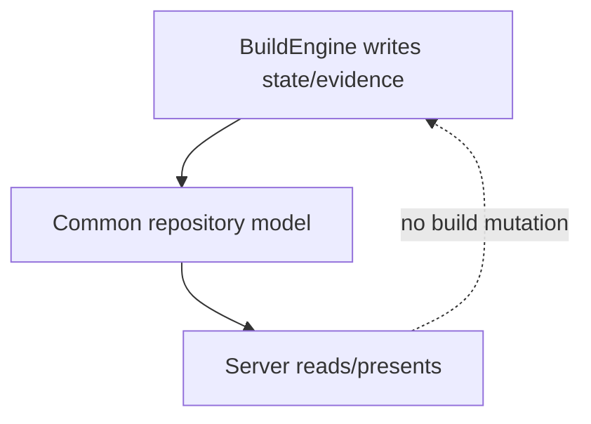

# BuildEngine Server

[TOC|Content]

**Current catalog, 17 November 2026:** Schema 17 declares **116 versioned library records across 81 logical IDs**. The 10 November historical snapshot comprised 95 records across 62 IDs, including 32 `supersededBy` entries. Build success evidence remains tied to its exact FSM and binary revision. [Full catalog](/manual/libraries.md) · [Change history](/news/).

**Status:** server contract reviewed 21 October 2026. The server is Common-based, but several extension/package details are still open implementation issues and are explicitly identified below.

BuildEngine Server is the read-only HTTP presentation and machine-interface layer for one BuildEngine production tree. It exposes the logical library catalog, package metadata, generated documentation, CycloneDX data, dependency/usage information, security results, package export, project documentation and a browser UI.

The server is **not** an independent state or repository authority.

The server's **primary purpose is the live, read-only visualization of the BuildEngine working environment**. It also serves existing HTML files and renders repository-managed Markdown documents with syntax highlighting, Mermaid diagrams, and MathJax where required by the document. Library and package data are read from the configured environment, while narrative documentation is prepared separately from project owner materials, architectural specifications, blog posts, development history, and repository revisions with AI editorial assistance. The shared footer links to [About This Site: Live BuildEngine View and Documentation Provenance](/manual/about-this-site.md), which explains this distinction and the verification rules.


## Passive internal HTTP server and in-memory cache (17 November 2026)

The server remains a **read-only GET-only HTTP service**. HTTPS certificates, external authentication, rate limiting and TLS termination belong to the trusted firewall or reverse proxy. The internal hop may remain HTTP on a private, explicitly bound interface. There is **no** application request telemetry, search history, cookie tracking, or browser preference persistence.

### Deployment controls

The already supported `BuildEngine.xml` `<parameters>` attributes `serverAddress`, `serverName` and `serverPort` select a concrete local interface, expected Host identity and HTTP port. The following optional attributes provide the stricter deployment contract:

| Parameter | Default | Meaning |
| --- | --- | --- |
| `serverAllowedNetworks` | `127.0.0.1/32,::1/128` | Explicit comma-separated IPv4/IPv6 CIDR networks of allowed **direct TCP peers** |
| `serverWorkers` | `4` | Fixed worker pool (1–32) with bounded pending queue |
| `serverDownloadsEnabled` | `false` | Permit or reject ZIP download endpoint and hide its link |
| `serverSecurityRefreshEnabled` | `true` when not explicitly set in the central configuration | Enable independently scheduled OSV/NVD/EPSS/KEV collection |
| `serverSecurityRefreshMinutes` | `1440` | Scan period, 15–10080 minutes |

When enabling a reverse proxy, allowlist the **proxy's internal source IP**, not arbitrary client addresses. `X-Forwarded-For` is **not trusted for access authorization**. The reverse proxy must enforce its own authentication and inbound access policies. Wildcard listener addresses remain prohibited. IPv4/IPv6 CIDR prefix `/0` is rejected.

The HTTP server uses a fixed, bounded worker pool, size-limited request headers and receive/send timeouts. Published overview HTML for Dashboard, Libraries, Packages, Security and the local Security inventory is built in a background thread and atomically swapped as an immutable in-memory snapshot. The refresh worker fingerprints XML **content** and installed SBOM and documentation evidence every five seconds. Failed source reads invalidate the overview snapshot, never silently promoting stale metadata.

Individual package and security details read BuildEngine package evidence and the **independent in-memory CVE snapshot only**. HTTP requests never trigger CVE provider queries or SQLite archive reads. The periodic security worker uses `SecurityMonitorService` to retrieve OSV, NVD, EPSS and CISA KEV data. It atomically publishes independent partial snapshots during the scan and the final result even when individual provider or enrichment calls fail. Only successful OSV responses mark a package as `scanned`; partial results do not imply complete coverage. No provider scan is started by an incoming HTTP request. Until persistent evidence is integrated, coverage after startup remains `not-scanned` until the security worker publishes results.

### Security, package and catalog presentation

XML timestamps are shown alongside the package coordinate across Dashboard/Libraries/Packages/Security. Package and Security overview tables have local-only name search, sortable Name/Category/XML timestamp and optional superseded hiding. Security findings expand to reveal evidence details, known fixes and upstream links; compact columns show normalized Severity, CVSS, EPSS, Percentile, KEV and Fix. Absent CVSS/EPSS evidence remains unknown rather than being assigned zero.

The package ZIP export route exists only when explicitly enabled. The server must **not** expose the administrative filesystem as an unrestricted static web root. The shared physical-payload ownership caveat for extension ZIP exports remains a separate correctness constraint and is not solved merely by a download toggle.

This section records the implemented repository contract. Native BCC64X/server concurrency tests, proxy configuration and deployment approval are separate operational gates; no new performance metric is asserted here.

## Dependency closure display (15 November 2026)

The version detail page at `/library/{library}/{version}` and the installed package page at `/package/{library}/{version}` now expose three expandable component inventories: **Direct dependencies**, **Transitive dependencies**, and **Bundled components**. Direct package relationships are classified from the authoritative BuildEngine XML catalog. The complete external component closure and embedded third-party components are derived from the installed CycloneDX SBOM. The existing four-part summary of direct, transitive, bundled and overall components remains, and each list includes distinct library/version coordinates without double counting.

The direct and transitive entries link to versioned library detail pages. Bundled components are explicitly labeled as embedded and do not link to nonexistent BuildEngine package coordinates. The display reads existing repository data: it neither creates another dependency source of truth nor asserts that a newly registered library has been installed. Pages for uninstalled versions continue to show the configured direct relationships only, and must not fabricate an SBOM closure.

The normalized `/api/v1/library/{library}/{version}` JSON also exposes the `componentList[].relation` values `root`, `direct`, `transitive`, and `bundled`. These values correspond to the same categorization displayed in the HTML tables. All direct edges that have not yet been installed are visible only in the configuration section, not as existing SBOM components.

**Verification:** Changes to BuildEngine-Common have been committed. Deployment, BCC64X compilation and browser tests have not yet been performed in the production environment. The operator confirmed `libwebp@1.6.0` built successfully; the new Skia build was still in progress.

## Server-facing catalog update (10 November 2026)

The synchronized Schema-17 contract declares **95 library/version records across 62 logical IDs**. 32 version lines have a `supersededBy` successor; both a predecessor and a successor remain addressable where logically installed. The server must reflect the resolved catalog, not assume that a directory count, a previous 44-library figure, or a file's presence proves successful installation. Details: [full inventory](libraries.md).

The current `pdfium@2025.11.19` XML contract references Skia 153, ICU 79.1, FreeType 2.15.0, LittleCMS 2.20, zlib 1.4 and external Abseil 20260817.0. This is the **declared** dependency graph; binary verification must come from the latest build/smoke evidence. See [PDF workflow](pdf-processing.md).

The REST/browser layer remains **read-only** and must show provenance/status from package/machine evidence. The existing Common extension existence, ownership and ZIP export gaps described below remain explicitly **unverified**; this documentation refresh does not declare them fixed.

## Common/DLL is the leading repository view

A physical package directory is not sufficient to identify every logical library. Extensions may intentionally share a payload with their base library.

TAO is the reference case:

```text
logical library: tao 4.0.6
base:            ace 8.0.6
physical payload: install/packages/ace/8.0.6/
logical metadata: install/packages/ace/8.0.6/.buildengine/extensions/tao/4.0.6/
```

The server consumes `LibraryCatalog` and `BuildEngineRepository` from BuildEngine-Common.



Server-specific filesystem heuristics must not be added to compensate for a Common repository bug.

## One production tree

BuildEngine writes the production tree. Common interprets it. Server and Manager consume that interpretation.



The server does not maintain a second persistent copy of package, SBOM, documentation or security state.

## Current Common audit status

The logical catalog infrastructure is present, but the 15 September repository audit found several active implementation gaps.

### Logical route existence

`BuildEngineRepository::LibraryExists()` and `VersionExists()` currently still test physical package directories.

That is incorrect for an extension that has no sibling `install/packages/<extension>/<version>` tree. Therefore an extension can be present in `/api/v1/libraries` yet an individual route may currently return an incorrect `404`.

**Required fix:** make existence checks catalog-based in Common and distinguish configured/logically known from installed/metadata-available.

### Installed state

Catalog list functions currently infer `installed` from the physical payload directory. For an extension, the base payload may already exist before the extension has actually completed its logical installation.

**Required fix:** define extension-aware logical installed evidence without creating a new competing Current-State system.

### Artifact evidence

The intended artifact contract includes relative path, size and SHA-256. Current Common `ArtifactManifest` still stores only path and size.

This means same-size content changes are not detected yet.

### Package export

`PackageExporter` currently iterates each logical component's physical `PackageRoot` recursively. When ACE and TAO share the same physical payload, this can duplicate or mislabel content in the ZIP.

**Required fix:** package export must consume the same central ownership/closure interpretation as Publish and future cleanup.

Until these fixes are implemented and verified, server documentation must not claim that all extension routes or shared-payload exports are fully correct.

## Transport and scope

Safe defaults:

```text
serverAddress="127.0.0.1"
serverName="localhost"
serverPort="8765"
```

The endpoint is configured in `BuildEngine.xml`.

`common::HttpServer` rejects unspecified and multicast bind addresses. Wildcard addresses such as `0.0.0.0` or `::` are therefore not valid listener configuration.

Only HTTP `GET` is part of the current server contract. The intended deployment is localhost or a protected internal network.

## Browser routes

Important routes include:

| Route | Purpose |
| --- | --- |
| `/server/` | Dashboard |
| `/status/` | Effective status |
| `/libraries/` | Logical library catalog |
| `/library/{library}/{version}/` | Library/version detail |
| `/pdf/{library}/{version}` | PDF documentation |
| `/packages/` | Package overview |
| `/package/{library}/{version}/` | Package detail/export |
| `/security/` | Security overview |
| `/security/{library}/{version}/` | Security detail |
| `/news/` | Chronological BuildEngine change history from `admin/server-docs/news/index.md` |
| `/news/YYYY-MM-DD/` | Datierter News-Eintrag `news-YYYY-MM-DD.md` |
| `/package/{library}/{version}/migration` | Version-specific configuration, integration notes and transitive Mermaid dependencies |
| `/manual/*.md` | Synchronized project/server documentation |
| `/index.html` | Generated central documentation index |

## PostgreSQL-backed server state

BuildEngine Server uses a PostgreSQL database named **BuildEngine** to persist
selected cache data, security findings and assessments. Persisted information is
used to restore server state at startup and to retain the history of changes
over time.

**Integration status:** PostgreSQL persistence and startup restoration are being
implemented; the currently deployed server still uses its in-memory CVE
snapshot. The database is not yet required for normal server operation.

## Machine API

The machine API is GET-only. The versioned namespace is `/api/v1`; responses are JSON except for the downloadable ZIP. The server performs no outbound provider requests for an incoming HTTP request. Invalid routes return 404 and non-GET requests are rejected with 405.

### Implemented endpoints

| Endpoint | Data returned |
| :--- | :--- |
| `GET /api/v1/status` | Application/API versions, API roots, bind, server name, port, worker count, download enablement, transport description. |
| `GET /api/v1/tools` | Production-root tool inventory. |
| `GET /api/v1/libraries` | `count` and `libraries[]`: logical library ID, name, version, category, description, XML timestamp, `supersededBy`, `licenseSignal`, installed/SBOM/documentation flags and optional extension relation. |
| `GET /api/v1/libraries/{library}` | `count` and `versions[]`: versions with names, categories, descriptions, XML timestamps, license signals, supersession, installed/SBOM/license-info/documentation flags. |
| `GET /api/v1/libraries/{library}/{version}` | Version metadata including `name`, `category`, `description`, `installed`, `timestamp`, `supersededBy`, `licenseSignal`, normalized CycloneDX root `component`, direct `dependencies[]`, `dependencyCount`, SBOM/license-info/documentation flags, CycloneDX version. |
| `GET /api/v1/libraries/{library}/{version}/dependencies` | Direct SBOM edges (`library`, `version`, `bundled`) and count, not a full closure. |
| `GET /api/v1/libraries/{library}/{version}/usage` | Reverse package consumers (`library`, `version`, `relation` = `direct` or `transitive`), count; currently computed by traversing other SBOM closures. |
| `GET /api/v1/libraries/{library}/{version}/findings` | Exact-package in-memory CVE observations: `queryStatus`, `findingCount`, `findings[]`, `providerMode` and `kevCatalogAvailable`; not the dependency closure. |
| `GET /api/v1/library/{library}/{version}` | Package closure and relation categories, count of direct, transitive and bundled components, package/SBOM/license-info paths, metadata fields, optional CycloneDX `dependencyGraph`. |
| `GET /api/v1/sbom/{library}/{version}` | The full published CycloneDX JSON, including any component, license, PURL, dependency, hash or external-reference evidence present in that document. |
| `GET /api/v1/risk/{library}/{version}` | Root and installed dependency-closure CVE findings; `findingCount`, `rootFindingCount`, `queriedComponents`, `components[]`, XML timestamp and assessment placeholder. |
| `GET /api/v1/package/{library}/{version}/download` | On-demand package-closure ZIP, only if downloads are enabled in the server configuration. |

The two similar package routes, `/libraries/{library}/{version}` and `/library/{library}/{version}`, have different payloads: the former describes the root component and direct edges; the latter describes the complete published component closure. These are existing contracts, not aliases.

### Nested payloads and semantics

The normalized `component` in a version detail includes `name`, `version`, `type`, `purl` and `bomRef`, plus optional `description`, `supplier`, `licenses`, `externalReferences` and `properties`.

The package-closure `componentList[]` records `library`, `version`, `relation` (`root`, `direct`, `transitive` or `bundled`), `bundled`, and `packageRoot` when not bundled. The package totals include `components`, `buildEngineDependencies`, `directDependencies`, `transitiveDependencies` and `bundledComponents`. Source-of-truth metadata is the logical catalog and installed CycloneDX evidence, not filesystem directory proximity.

Security `findings[]` records can include `id`, `primaryId`, `component`, `componentVersion`, `summary`, `details`, OSV `published` and `modified` timestamps, `providerSeverity`, `cvssSeverity`, `cvssVersion`, `cvssVector`, optional numeric `cvss`, `epss` and `percentile`, `kev`, `kevStatus`, `fixAvailable`, `fixedVersions[]` and `links[]`.

The browser detail view interprets available CVSS 3.0, 3.1 and 4.0 base vectors in English. CVSS 4.0 uses Attack Requirements and distinct Vulnerable/Subsequent System impacts rather than the CVSS 3.x Scope metric. Recognized additional CVSS 4.0 metrics are interpreted when present. The vector remains source evidence: the interpretation neither modifies the reported score nor establishes vulnerability applicability to the current build. Missing, incomplete or unsupported vector formats are not assigned invented values. Missing numeric evidence is not a score of zero. The KEV status is `yes`, `no` or `unknown`; `kevCatalogAvailable=false` means that negative KEV conclusions cannot be trusted. `queryStatus=not-scanned` does **not** establish absence of vulnerabilities.

The `/risk` endpoint includes the root package and its dependency closure. Individual `/findings` is restricted to the queried package. Bundled components are reported separately. The `assessment` field currently reports `status=not-loaded` until the PostgreSQL-backed assessments integration becomes available.

### Missing first-class package data

| Area | Currently not provided as an independent, normalized REST contract |
| :--- | :--- |
| Build provenance | Verified upstream commit, source archive hash, applied patches, compiler/ABI and build variant, compile/link options, artifact inventory and fingerprints, reproducibility and tests per configuration. Some raw evidence may exist outside this API. |
| Licensing | Complete normalized license/notice texts and licensing assessment; existing data is `licenseSignal`, availability flags and raw CycloneDX licenses. |
| Security scan health | Last successful run timestamp, scan ID, per-provider failure diagnostics, complete coverage indicator, and CVE attribution confidence. Advisory identity and installed-version applicability are separate questions; a shared Git repository alone is insufficient. |
| Assessments | Persisted decisions and review histories are planned for PostgreSQL; they are not yet available through the REST API. |
| Dependency contracts | Unified view comparing configured-but-not-installed XML dependencies with installed CycloneDX edges, including discrepancies. |
| FSM and execution | BuildEngine lifecycle and state per library/variant, job/task history, build/test status and progress. `/status` describes the HTTP server, not the BuildEngine job scheduler. |

These are documented gaps, not values to guess. In particular, `findingCount=0` must not be interpreted as verified security clearance. The current extension route-validation and ownership-safe ZIP-export limitations remain separately documented below.

### API examples

```text
GET http://127.0.0.1:8765/api/v1/libraries/curl/8.21.0
GET http://127.0.0.1:8765/api/v1/library/curl/8.21.0
GET http://127.0.0.1:8765/api/v1/libraries/curl/8.21.0/dependencies
GET http://127.0.0.1:8765/api/v1/libraries/curl/8.21.0/findings
GET http://127.0.0.1:8765/api/v1/risk/curl/8.21.0
GET http://127.0.0.1:8765/api/v1/sbom/curl/8.21.0
```

The URLs demonstrate the route contract; they are not runtime test results. These endpoints are versioned read-only interfaces. Package identity and vulnerability applicability must always remain explicit.

## Current catalog breadth

The synchronized XML contract declares **95 versioned entries / 62 logical third-party library IDs** across compression, archives, security, networking, embedded/client-server databases, middleware, graphics, image codecs, testing, text/Unicode, XML and PDF/document processing.

Recent additions include the PostgreSQL client pair libpq/libpqxx and the document-processing branch win-iconv/libxml2/QPDF/PoDoFo/Poppler. The Server presents these from the same Common catalog and license/security metadata as every earlier library; it does not maintain a separate hard-coded roster.

## Dependency and usage data

Direct dependencies, closure and reverse usage are derived from logical CycloneDX/component relationships. Physical directory proximity does not create a dependency.



## License traffic lights in the browser UI

The library catalog carries the `metadata/@licenseSignal` value through BuildEngine-Common into the live server presentation.

The same signal is rendered on the dynamic HTML views for:

- the library overview in tile and list mode;
- library/version pages;
- library detail pages;
- package overview and package detail pages;
- the security overview.

The browser uses the same semantic values as the admin contract:

- **Green** — normal proprietary integration with ordinary license/notice obligations;
- **Yellow** — explicit product-specific licensing/integration review required;
- **Red** — do not plan as an in-process proprietary dependency.

The license signal is independent of the security assessment traffic light. A library can be license-green while still having security findings, or license-red while having no known vulnerability.

The REST library representations also expose `licenseSignal` so Server, Manager and other clients consume the same Common interpretation.

## Security

Security views combine:

- logical component identity,
- CycloneDX data,
- provider findings,
- approved local BuildEngine assessments.

Security and package views must enumerate logical catalog entries rather than treating the physical `packages` directory as the catalog.

## Documentation rendering

The server renders/supplies:

- synchronized Markdown,
- Mermaid,
- syntax highlighting,
- MathJax where requested,
- generated Doxygen HTML,
- generated PDFs.

It does not decide Doxygen state or inputs. Documentation generation belongs to BuildEngine.

## Read-only boundary



Build execution, state transitions, installation and artifact inventory belong to BuildEngine. Shared interpretation belongs to Common.

## Development rule

When repository semantics change:

1. correct the Common model;
2. adapt shared services if necessary;
3. let Server/Manager follow the Common contract;
4. do not create application-local parsers or ownership heuristics.

## Verification status

The current Common/Server extension corrections are **not verified** until a later explicitly approved C++Builder/BCC64X build and server/API test is performed. No such run was started during this documentation cleanup.
